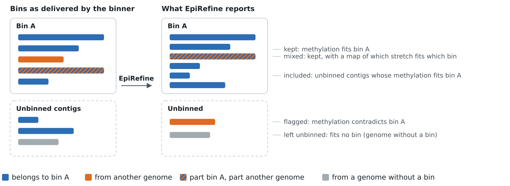

# EpiRefine

[](https://github.com/SorenHeidelbach/epirefine/actions/workflows/tests.yml)
[](https://pypi.org/project/epirefine/)
[](https://pypi.org/project/epirefine/)
[](https://github.com/SorenHeidelbach/epirefine/blob/main/LICENSE)

**Refine metagenome bins with nanopore methylation.** EpiRefine takes the bins from any binner and checks every
contig against the methylation fingerprint of its bin. It removes contigs that don't belong (contamination) and
puts unbinned contigs, such as plasmids, into the bin whose methylation they share. Every decision comes with a
calibrated probability.



Bacteria methylate short DNA motifs everywhere in the cell, on the chromosome and on its plasmids and phages
alike, and nanopore reads record that methylation. The set of methylated motifs is therefore a signature of the
genome a contig comes from, and it is independent of the sequence composition and coverage that binners use.

**Contents:** [Install](#install) · [Quick start](#quick-start) · [What you get](#what-you-get) ·
[Documentation](#documentation) · [When to trust it](#when-to-trust-it) · [Citing](#citing)

## Install

```bash
pip install epirefine
```

or with conda (Bioconda):

```bash
conda install -c conda-forge -c bioconda epirefine
```

Python 3.10 or newer; Linux and macOS. Check it works with `epirefine --version`.

## Quick start

You need four files for the sample:

| Input | What it is | Made with |
|---|---|---|
| `assembly.fasta` | the assembled contigs | any assembler (e.g. metaFlye) |
| `contig_bin.tsv` | which bin each binned contig is in: `contig<TAB>bin`, no header | any binner |
| `pileup.bed` | reads called modified / unmodified at every position | `modkit pileup` |
| `bin-motifs.tsv` | the methylated motifs found in the bins | `nanomotif motif_discovery` |

Then run:

```bash
epirefine run \
    --assembly assembly.fasta \
    --contig-bin contig_bin.tsv \
    --pileup pileup.bed \
    --motifs bin-motifs.tsv \
    --out epirefine_out \
    --workers 16
```

New to nanopore methylation? The [getting-started guide](https://github.com/SorenHeidelbach/epirefine/blob/main/docs/getting-started.md)
walks through making the pileup and the motif file, running EpiRefine, and writing the refined bins as FASTA.

## What you get

The refined binning is in **`epirefine_out/new_contig_bin.tsv`** (`contig<TAB>bin`): the bins without their
contaminants and with the included contigs added. Every contig's decision, with its probabilities, is in
**`contig_decisions.tsv`**:

| Status | Meaning |
|---|---|
| `kept` | binned, and its methylation fits its bin |
| `contaminant` | binned, but its methylation contradicts its bin: removed |
| `moved` | a contaminant that clearly belongs to another bin: moved there |
| `mixed` | a long contig that is partly its bin's and partly another genome's: kept, with a map of which stretch fits which bin |
| `included` | unbinned, and its methylation fits one bin: added to it |
| `unbinned` | unbinned, and no bin fits well enough: left out |
| `redundant` | unbinned; would be included, but its sequence is already in the bin |
| `low_coverage`, `too_short`, `no_methylation_evidence`, `sole_contig_of_bin` | not judged: too few reads, too short, no informative methylation, or nothing to compare it with |

The files `bin_contamination.tsv`, `include_contigs.tsv` and `decontaminated_contig_bin.tsv` have the same format
as Nanomotif's, so pipelines built for Nanomotif's refinement can use EpiRefine's output directly. All files are
described in [docs/outputs.md](https://github.com/SorenHeidelbach/epirefine/blob/main/docs/outputs.md).

## Documentation

| Guide | For |
|---|---|
| [Getting started](https://github.com/SorenHeidelbach/epirefine/blob/main/docs/getting-started.md) | a first run, step by step, from reads to refined bins |
| [Options](https://github.com/SorenHeidelbach/epirefine/blob/main/docs/usage.md) | every command-line option, its default and when to change it |
| [Outputs](https://github.com/SorenHeidelbach/epirefine/blob/main/docs/outputs.md) | every output file and column |
| [How it works](https://github.com/SorenHeidelbach/epirefine/blob/main/docs/how-it-works.md) | the model in plain terms, from read counts to decisions |
| [FAQ and troubleshooting](https://github.com/SorenHeidelbach/epirefine/blob/main/docs/faq.md) | common questions, runtime, memory, odd results |
| [Changelog](https://github.com/SorenHeidelbach/epirefine/blob/main/CHANGELOG.md) | what changed in each version |

## When to trust it

- **When EpiRefine acts, it is almost always right.** On benchmarks with known truth, every flagged contig was a
  true contaminant and 99-100% of placements were into the right bin. It found 90-97% of planted contaminants,
  against 13-34% for Nanomotif's refinement on the same data.
- **It declines rather than guesses.** Contigs below 5x coverage, shorter than 1 kb or without informative
  methylation get no decision. On a complex fecal sample that was about half of the assembly.
- **Methylation cannot separate genomes that methylate the same motifs**, such as very close strains. EpiRefine
  then keeps both bins in its credible set or leaves the contig where it is.

More in the [FAQ](https://github.com/SorenHeidelbach/epirefine/blob/main/docs/faq.md).

## Citing

A manuscript is in preparation. Until then, please cite this repository and the version you used
(`epirefine --version`). EpiRefine builds on [Nanomotif](https://github.com/MicrobialDarkMatter/nanomotif) for
motif discovery and on [modkit](https://github.com/nanoporetech/modkit) for the pileup.

## Contributing

Bug reports and questions: [GitHub issues](https://github.com/SorenHeidelbach/epirefine/issues). To work on the
code:

```bash
git clone https://github.com/SorenHeidelbach/epirefine.git && cd epirefine
uv venv && uv pip install -e ".[dev]"
.venv/bin/pytest -q
```

Development rules are in [CLAUDE.md](https://github.com/SorenHeidelbach/epirefine/blob/main/CLAUDE.md), the
benchmark used for every release in `benchmarks/` (results per version in
[benchmarks/results.tsv](https://github.com/SorenHeidelbach/epirefine/blob/main/benchmarks/results.tsv)), and
notes on the statistical model and performance in
[docs/development/](https://github.com/SorenHeidelbach/epirefine/tree/main/docs/development).

Licence: [MIT](https://github.com/SorenHeidelbach/epirefine/blob/main/LICENSE).
