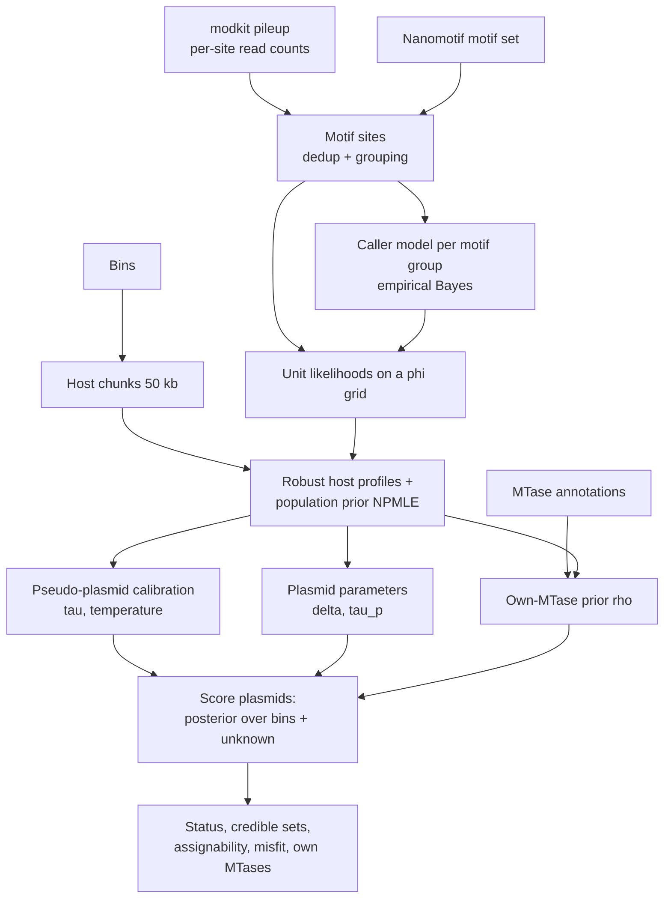

# Method notes (developer)

> **For users:** see [how-it-works.md](../how-it-works.md). These are developer notes on the statistical model,
> written for EpiRefine's predecessor, a plasmid-host assigner, and kept for the derivations.
>
> **Status (0.5.0):** EpiRefine is now bin refinement only (contamination detection and contig
> inclusion). This document was written for the plasmid-host version and still describes the
> shared model (sites, caller model, grid, host profiles, population prior, "unknown", calibration)
> correctly. Obsolete: own MTases (4.7, 6.5), the plasmid parameters δ and τ_p (6.6), plasmid
> statuses and detectability (8.2). Not yet described here: the refinement decisions (EM share of
> foreign contigs per bin, the credible-interval effect size, inclusion posterior), the caller
> model fitted with bins as labels, the "relative of a bin" unknown, the logit-normal variation
> kernel and the k-mer redundancy check. Those are documented in the dev log's DECISIONS.md
> (D11, D19, D20, D21) and in the docstrings of `refine.py`, `detection.py` and `redundancy.py`.

**Probabilistic plasmid–host assignment from nanopore DNA methylation**

This document describes the statistical model behind EpiRefine v2, how each part is estimated, how
uncertainty is reported, and why each design choice was made. It matches the implementation in
`src/epirefine/` (module names are given in each section). For usage, see the [README](../../README.md).

---

## Contents

1. [Problem statement](#1-problem-statement)
2. [Overview of the approach](#2-overview-of-the-approach)
3. [Data and features](#3-data-and-features)
4. [The generative model](#4-the-generative-model)
5. [Inference: scoring a contig against a host](#5-inference-scoring-a-contig-against-a-host)
6. [Estimating the model's parameters](#6-estimating-the-models-parameters)
7. [Self-calibration with pseudo-plasmids](#7-self-calibration-with-pseudo-plasmids)
8. [Uncertainty, assignability and diagnostics](#8-uncertainty-assignability-and-diagnostics)
9. [Why this approach](#9-why-this-approach)
10. [Assumptions and limitations](#10-assumptions-and-limitations)
11. [Validation so far](#11-validation-so-far)
12. [Computation](#12-computation)
13. [Parameter reference](#13-parameter-reference)
14. [Notation](#14-notation)
15. [References](#15-references)

---

## 1. Problem statement

A metagenome assembly contains contigs from many organisms. Genome binning groups chromosomal
contigs into metagenome-assembled genomes (MAGs, here "bins"). Plasmids are poorly served by
binning:
- they are short
- their sequence composition differs from the host's
- their coverage reflects copy number rather than host abundance
- they can occur in several hosts

So they usually end up unbinned or in the wrong bin.

Bacterial DNA methyltransferases (MTases) modify adenine or cytosine at specific sequence motifs
(e.g. 6mA at G**A**TC, 4mC or 5mC at other motifs). Each strain has its own set of active MTases (its
*methylome*), and every DNA molecule replicated in that cell is methylated by them, including
plasmids. Nanopore sequencing detects these modifications directly. A plasmid therefore carries its
current host's methylation "fingerprint". Nanomotif (Heidelbach et al.) discovers the methylated motifs
of each bin from such data.

**The task.** For each plasmid candidate contig $u$, given the per-site methylation calls across the
assembly, the bins and the motif set, compute:

- a posterior distribution over the host bins **and an explicit "unknown host" class**;
- an honest measure of how confident that assignment can be (credible set, Bayes factors);
- whether the data could have resolved the host at all (*assignability*);
- which motifs the plasmid methylates with its own MTase, and which motifs its assigned host fails
  to explain.

---

## 2. Overview of the approach

The method is a **hierarchical Bayesian model**:

$$
\underbrace{k_i \mid n_i, s_i}_{\text{reads at a site}}
\;\leftarrow\; \underbrace{s_i \mid \phi_{um}}_{\text{site methylated?}}
\;\leftarrow\; \underbrace{\phi_{um} \mid \phi_{hm}, w_{um}}_{\text{contig vs host}}
\;\leftarrow\; \underbrace{\phi_{hm}}_{\text{host methylome}}
\;\leftarrow\; \underbrace{\pi_m}_{\text{community}}
$$

**What is learned from the sample itself (empirical Bayes):**
- every level's parameters: caller error rates, overdispersion, between-contig variation, plasmid offsets
- the community prior over methylomes
- the reliability of MTase annotations

**External information it uses:** only the motif list from Nanomotif and, optionally, plasmid
candidates and MTase annotations.

**What it reports:** posteriors, which are made trustworthy by calibrating on pseudo-plasmids cut
from the sample's own host contigs.

---

## 3. Data and features

*Modules: `io.py`, `motifs.py`.*

### 3.1 Inputs

| Input | Content used |
|---|---|
| Assembly FASTA | Contig sequences (for motif search) and lengths |
| `modkit pileup` bedMethyl | For each reference position, strand and modification code: $N_{\text{valid}}$ (reads with a valid call) and $N_{\text{mod}}$ (reads called modified) |
| `contig_bin.tsv` | Host bins |
| Nanomotif `bin-motifs.tsv` | The **union** of motifs (IUPAC sequence, modified position, modification type), including `motif_complement` |
| Plasmid candidates (optional) | geNomad summary or a contig list |
| MTase annotations (optional) | Per MTase gene: contig, modification type, predicted motif |

**Only the motif list is taken from Nanomotif**, not its per-bin presence calls. Which hosts
methylate which motif is re-estimated from the read counts (§6.3). This keeps the method robust to
motif-calling errors in individual bins and lets it use motifs that are present in only some bins.

### 3.2 Records

A motif $M$ with modified position $p$ and length $\ell$ is searched on both strands with overlapping
IUPAC regular expressions. An occurrence starting at $s$ on the forward strand gives a record at
$(s+p, +)$. An occurrence of the reverse complement at $s$ gives a record at $(s + \ell - 1 - p, -)$.
A *record* is one (contig, position, strand, modification type) and matches exactly one pileup row.

### 3.3 Sites: removing double counting

The model's unit of evidence is a **site**, a set of records that share one biological methylation
event. Three rules prevent the same evidence being counted twice:

1. **Palindromes.** For a palindromic motif (e.g. GATC) the $+$ and $-$ records of one occurrence form
   one site. Their counts are summed: $n_i = \sum_r N_{\text{valid},r}$ and $k_i = \sum_r N_{\text{mod},r}$.
2. **Reverse-complement pairs.** A motif and its reverse complement with the same modification type
   (typically a Type I bipartite motif and its complement, e.g. GAGNNNNNGTCA / TGACNNNNNCTC) are
   canonicalised to one motif, so the records of one occurrence share a site.
3. **Motif groups.** Motifs with the same modification type whose record sets overlap strongly are
   merged into a *group* (the model's feature) by union–find. The criterion is
   $$
   \frac{|R_A \cap R_B|}{\min(|R_A|, |R_B|)} \;\ge\; 0.5 ,
   $$
   which merges nested motifs (e.g. GATC ⊃ RGATCY). Each record is counted at most once within a
   group, and is claimed by the group's motif with the most records.

**Cross-group records are dropped.** A record matched by motifs of *different* groups is removed
from all of them. Example: the A in TCGANTC belongs to both TCGA and GANTC. Its methylation could
come from either MTase, so keeping it in both groups would leak one MTase's signal into the other.
This was observed directly in testing: a plasmid's own GANTC MTase made about 8% of "TCGA" sites look
methylated, and no host explained that. The cost is a few percent of records.

### 3.4 Units and chunks

A **unit** $u$ is any stretch of sequence scored as one entity:
- a **plasmid candidate contig**;
- a **host chunk**: host (binned, non-candidate) contigs are cut into chunks of $C = 50$ kb, and each
  chunk is a unit;
- a **pseudo-plasmid fragment** used for calibration (§7).

Plasmid candidates that a binner placed inside a bin are removed from that bin before host profiles
are built.

---

## 4. The generative model

*Modules: `detection.py`, `grid.py`, `model.py`.*

### 4.1 Detection layer: read counts given a site's state

Each site $i$ of motif group $m$ is either methylated ($s_i = 1$) or not ($s_i = 0$) in the
population of molecules it came from. Given the state, the number of reads called modified follows a
beta-binomial distribution:

$$
k_i \mid n_i, s_i = 0 \;\sim\; \mathrm{BetaBin}\!\big(n_i;\; \mu_{0m}\kappa_{0m},\; (1-\mu_{0m})\kappa_{0m}\big),
$$
$$
k_i \mid n_i, s_i = 1 \;\sim\; \mathrm{BetaBin}\!\big(n_i;\; \mu_{1m}\kappa_{1m},\; (1-\mu_{1m})\kappa_{1m}\big),
$$

with pmf

$$
\mathrm{BetaBin}(k; n, a, b) = \binom{n}{k} \frac{B(k + a,\, n - k + b)}{B(a, b)} .
$$

**The four parameters per group:**
- $\mu_{0m}$: mean fraction of reads called modified at an *unmethylated* site, i.e. the caller's
  **false-positive level** for this sequence context.
- $\mu_{1m}$: the same at a *methylated* site, i.e. the **detection ceiling**: incomplete methylation,
  missed calls and threshold effects keep it below 1.
- $\kappa_{0m}$, $\kappa_{1m}$: concentrations. A small $\kappa$ means strong overdispersion between
  sites, beyond binomial read sampling.

The parameterisation keeps the components ordered: $\mu_0 \in (0, 0.5)$ and $\mu_1 \in (0.5, 1)$.

The binomial coefficient is the same under every hypothesis, so it is dropped from all likelihoods.
Bayes factors and posteriors are unaffected; reported log-likelihoods are therefore relative.

### 4.2 Site layer: how many of a unit's sites are methylated

Within unit $u$, the sites of group $m$ are methylated independently with probability $\phi_{um}$:

$$
s_i \mid \phi_{um} \;\sim\; \mathrm{Bernoulli}(\phi_{um}) .
$$

$\phi$ is the biologically interpretable quantity: **the fraction of the motif's sites that are
methylated**. It is near 1 when the host has an active MTase for the motif, near 0 when it does not,
and intermediate for partial or phase-variable methylation, or for groups that merge motifs only
some of which are methylated (e.g. GATC ∪ RGATCY in a host methylating only RGATCY gives
$\phi \approx 0.25$).

Summing over $s_i$, the likelihood of the unit's sites in group $m$ is

$$
L_{um}(\phi) \;=\; \prod_{i \in u,m} \Big[\phi\, f_{1m}(k_i \mid n_i) + (1 - \phi)\, f_{0m}(k_i \mid n_i)\Big],
$$

where $f_{sm}$ are the two beta-binomials above.

### 4.3 The φ grid

$\phi$ is represented on a fixed grid of $G = 64$ points $x_1 < \dots < x_G$, evenly spaced in logit
space between $\mathrm{logit}(10^{-3})$ and $\mathrm{logit}(1 - 10^{-3})$. Cell edges are the
logit-midpoints between neighbouring points, with $0$ and $1$ as the outer edges.

- **Densities are stored as cell masses.** A Beta density on the grid is
  $\Pr(\text{cell } j) = F_{\mathrm{Beta}}(e_{j+1}) - F_{\mathrm{Beta}}(e_j)$ (CDF differences), so the
  uneven spacing introduces no bias.
- **Log-likelihoods are stored per grid point.** For every unit and group:
  $$
  \mathcal{L}_{um}(g) = \log L_{um}(x_g) .
  $$
  This is computed once (vectorised over unique $(u, m, n, k)$ tuples) and reused for every
  hypothesis.

### 4.4 Unit layer: how a contig relates to its host

A unit's methylation level scatters around its host's level $\phi_{hm}$:

$$
\phi_{um} \mid \phi_{hm} \;\sim\; \mathrm{Beta}\!\big(\delta\,\phi_{hm}\,\tau,\; (1 - \delta\,\phi_{hm})\,\tau\big).
$$

- $\tau$ (concentration) controls between-unit variation; $\tau \to \infty$ means every unit shares
  its host's level exactly.
- $\delta \in (0, 1]$ scales the host level down. It captures **plasmid under-methylation**, for
  example an MTase that cannot keep up with a high-copy plasmid, or protein-bound sites.

Two parameter sets are used:

| Unit type | $\delta$ | $\tau$ |
|---|---|---|
| Host chunks and pseudo-plasmid fragments | 1 | $\tau_c$ (calibrated, §7) |
| Plasmid candidates | $\delta$ (fitted, §6.6) | $\tau_p$ (fitted, §6.6) |

On the grid this becomes a transition matrix,

$$
T_{ij} = \Pr\big(\phi_u \in \text{cell } j \mid \phi_h = x_i\big),
$$

a point mass at the cell containing $\delta x_i$ when $\tau = \infty$. The unit's own $\phi_{um}$ is
integrated out:

$$
\mathcal{L}'_{um}(i) \;=\; \log \sum_{j} T_{ij}\, e^{\mathcal{L}_{um}(j)}
\qquad \text{(log-likelihood as a function of the host level } x_i).
$$

### 4.5 Host layer: host profiles

A bin $h$ is a set of chunks $k$. With chunk weights $w_k$ (all 1 unless the robust step down-weights
them, §6.4), the bin's log-likelihood for group $m$ is

$$
\ell_{hm}(i) = \sum_{k \in h} w_k\, \mathcal{L}'_{km}(i),
$$

and its **host profile** is the posterior over its methylation level:

$$
p_{hm}(i) \;\propto\; \pi_m(i)\, e^{\ell_{hm}(i)} .
$$

### 4.6 Community layer: the population prior

$\pi_m$ is the distribution of host methylation levels for group $m$ across the community. It is
estimated nonparametrically from all bins (§6.3).

### 4.7 Own MTases

Plasmids often encode their own MTases (orphan MTases or complete restriction–modification systems).
Such a plasmid is methylated at the host's motifs *and* at its own. For each unit $u$ and group $m$
there is a latent indicator

$$
w_{um} \sim \mathrm{Bernoulli}(\rho_{um}),
$$

where $\rho_{um}$ comes from MTase annotations (§6.5).

- If $w_{um} = 0$, the unit's level follows its host as in §4.4.
- If $w_{um} = 1$, the level is set by the plasmid's own MTase and drawn from the **"present" part
  of the community prior**:
  $$
  q_m(i) \;\propto\; \pi_m(i)\,\mathbb{1}[x_i > 0.5],
  $$
  falling back to a $\mathrm{Beta}(20, 2)$ mass if no host in the community methylates $m$.

The unit still varies around that level through the same $(\delta, \tau)$ transition, so plasmid
under-methylation applies to the plasmid's own MTase too. (This matters in practice: without it, an
under-methylated plasmid with an unannotated own MTase was wrongly called "unknown".)

### 4.8 The "unknown host" class

The host of a plasmid is often not among the bins: it was unbinned, low-abundance or not assembled.
EpiRefine models this with an extra class, $h = 0$, whose methylation levels are a **random draw from
the community**. Its profile is the population prior itself, $p_{0m} = \pi_m$. The likelihood of a
unit under "unknown" is therefore the prior predictive: how probable the data are for a host chosen
at random from this community's methylome distribution.

### 4.9 Host prior

$$
\Pr(h = 0) = p_0, \qquad \Pr(h = b) = \frac{1 - p_0}{H} \quad (b = 1, \dots, H),
$$

with $p_0 = 0.1$ by default.

---

## 5. Inference: scoring a contig against a host

*Module: `model.py` (`group_scores`, `combine`, `posterior`).*

For unit $u$, group $m$ and candidate host $h$ (including $h = 0$), there are two explanations of
the group's data. If the host's MTase explains it:

$$
A_{uhm} = \log \sum_i \exp\!\big(\mathcal{L}'_{um}(i) + \log p_{hm}(i)\big) .
$$

If the plasmid's own MTase explains it:

$$
O_{um} = \log \sum_i \exp\!\big(\mathcal{L}'_{um}(i) + \log q_m(i)\big) .
$$

Groups are treated as conditionally independent given the host, so

$$
S_{uh} \;=\; \log p(\text{data}_u \mid h) \;=\; \sum_m \log\!\Big[(1 - \rho_{um})\, e^{A_{uhm}} + \rho_{um}\, e^{O_{um}}\Big].
$$

A group with no sites in the unit contributes exactly zero, so missing data are neutral.

The posterior over hosts, with a temperature $T \ge 1$ (§7.4), is

$$
\Pr(h \mid u) \;=\; \frac{\Pr(h)\, \exp(S_{uh} / T)}{\sum_{h'} \Pr(h')\, \exp(S_{uh'} / T)} ,
$$

and the posterior probability that group $m$ is methylated by the plasmid's own MTase, given host $h$,
is

$$
\Pr(w_{um} = 1 \mid u, h) = \frac{\rho_{um}\, e^{O_{um}}}{(1 - \rho_{um})\, e^{A_{uhm}} + \rho_{um}\, e^{O_{um}}} .
$$

**How the evidence works.** The motif groups act as a panel of binary-ish markers, and the
likelihood weighs them automatically:

- **Positive evidence.** A plasmid methylated at a motif that only host $h$ methylates is strong
  evidence for $h$. The evidence grows with the number of sites and their coverage.
- **Negative evidence.** A plasmid *unmethylated* at a motif that $h$ methylates is strong evidence
  *against* $h$. Absence of a mark is as informative as its presence; distance-based methods often
  ignore this.
- **Shared motifs.** A motif methylated by many hosts (e.g. Dam GATC) separates those hosts little,
  because all of them predict it; it still separates them from hosts that lack it. No ad hoc motif
  weighting is needed.
- **Own MTases are asymmetric.** The own-MTase term can explain *extra* methylation (cost:
  $\log \rho_{um}$) but never *missing* methylation. So a plasmid's own MTase cannot mask the strong
  negative evidence against a wrong host.

---

## 6. Estimating the model's parameters

All estimation uses the sample itself. There is no pre-trained component.

### 6.1 Order of estimation

| Step | Estimated | Data used | Method |
|---|---|---|---|
| 1 | $\mu_{0m}, \kappa_{0m}, \mu_{1m}, \kappa_{1m}$ | All sites in the sample | Penalised ML, two-level shrinkage (§6.2) |
| 2 | $\pi_m$, host profiles $p_{hm}$, chunk weights $w_k$ | Host chunks | NPMLE by EM (§6.3) + robust EM (§6.4) |
| 3 | $\tau_c$, temperature $T$ | Pseudo-plasmids | LOO marginal likelihood; log loss (§7) |
| 4 | $\rho$ (motif / mod-type level) | MTase annotations on bins vs host profiles | Smoothed proportions (§6.5) |
| 5 | $\delta$, $\tau_p$ | All plasmid candidates | Type-II maximum likelihood (§6.6) |

### 6.2 Caller model: empirical Bayes with two-level shrinkage

*Module: `detection.py`.*

For each group, the sites of the **whole sample**, with their unknown states marginalised, form a
two-component mixture:

$$
\log p(\mathbf{k} \mid \boldsymbol{\theta}_m) = \sum_i \log\!\big[\psi_m f_{1m}(k_i \mid n_i) + (1 - \psi_m) f_{0m}(k_i \mid n_i)\big].
$$

The parameters are transformed to an unconstrained vector:

$$
\boldsymbol\theta = \big(\mathrm{logit}(2\mu_0),\ \log\kappa_0,\ \mathrm{logit}(2\mu_1 - 1),\ \log\kappa_1\big).
$$

They are estimated by maximising the penalised log-likelihood

$$
\log p(\mathbf{k} \mid \boldsymbol\theta, \psi) - \tfrac{1}{2}\,\big\lVert(\boldsymbol\theta - \boldsymbol\theta^{\star}) / \sigma\big\rVert^2
$$

with L-BFGS-B, starting from three values of $\psi$. The data are compressed to unique $(n, k)$
pairs with multiplicities.

**Shrinkage in two levels:**
1. **Modification-type level** (6mA, 5mC, 4mC): all groups of the type are pooled. The prior centre
   $\boldsymbol\theta^\star$ corresponds to $\mu_0 = 0.05$, $\mu_1 = 0.85$, $\kappa = 10$, with a
   weak $\sigma = 3$.
2. **Group level**: each group's prior is centred on its type-level fit, with $\sigma = 1$. A group
   with little information (e.g. methylated nowhere, so $\psi \to 0$ and $\mu_1$ is unidentified)
   borrows the missing component from its modification type.

The mixture weight $\psi_m$ is a nuisance parameter: the fraction of all sites in the sample that
are methylated.

### 6.3 Population prior: nonparametric maximum likelihood (g-modelling)

For each group $m$, $\pi_m$ is the nonparametric maximum-likelihood estimate (NPMLE; Kiefer &
Wolfowitz 1956) of the distribution of host levels across the $B$ bins, computed on the grid by EM
(300 iterations):

$$
\pi_m^{(t+1)}(i) = \frac{1}{B}\sum_{b=1}^{B} \frac{\pi_m^{(t)}(i)\, e^{\ell_{bm}(i)}}{\sum_{i'} \pi_m^{(t)}(i')\, e^{\ell_{bm}(i')}} .
$$

This is Efron's (2016) *g-modelling*: the prior is deconvolved from the bins' noisy likelihoods
rather than being assumed to have a parametric shape.

Two safeguards follow:
- **Shrinkage** towards the mean prior of groups with the same modification type, $\bar\pi_{t(m)}$,
  with $\lambda = 5$ pseudo-bins. This stabilises motifs seen in only a few bins.
- **A uniform floor** $f = 0.02$, so no level is ever impossible. This keeps the "unknown" class and
  the own-MTase density from assigning zero probability to unusual observations.

$$
\pi_m \;=\; (1 - f)\,\frac{B\,\hat\pi_m + \lambda\,\bar\pi_{t(m)}}{B + \lambda} \;+\; \frac{f}{G}.
$$

### 6.4 Robust host profiles

MAG bins are often contaminated with contigs from other organisms. Each chunk $k$ of bin $b$ is
modelled as coming either from the bin's host (prior $1 - \varepsilon$) or from a random member of
the community (prior $\varepsilon = 0.05$). The posterior responsibility of the "foreign"
explanation is

$$
r_k = \sigma\!\Big(\log\tfrac{\varepsilon}{1-\varepsilon} + s^{\text{out}}_k - s^{\text{in}}_k\Big),
\qquad \sigma(z) = \frac{1}{1 + e^{-z}},
$$

where:
- $s^{\text{in}}_k = \sum_m \log\sum_i \exp\big(\mathcal{L}'_{km}(i) + \log p^{(-k)}_{bm}(i)\big)$ is
  scored against the bin's profile **with chunk $k$ left out**;
- $s^{\text{out}}_k = \sum_m \log \sum_i \exp\big(\mathcal{L}'_{km}(i) + \log \pi_m(i)\big)$.

The chunk weights become $w_k = 1 - r_k$. Profiles and the population prior are then refitted, and
the cycle repeats four times. The leave-one-out step matters: without it, a contaminating chunk would
partly explain itself.

The output `host_chunk_outliers.tsv` lists $r_k$ for every chunk, which doubles as a
bin-contamination check.

### 6.5 Own-MTase prior ρ from annotations

*Module: `mtase.py`.*

Every (unit, group) pair gets an annotation level:

| Level | Meaning | $\rho$ |
|---|---|---|
| 2 | An MTase on the unit has a predicted motif that is a member of the group (or its reverse complement) | $\rho_{\text{motif}}$ (default 0.8) |
| 1 | An MTase of the group's modification type, without a usable motif | $\rho_{\text{type}}$ (default 0.3) |
| 0 | No annotation | $\rho_{\text{base}}$ (default 0.02) |

When the host contigs are annotated too, the reliability of the annotations is measured on the
bins. For level $\ell \in \{1, 2\}$, with $\mathcal{P}_\ell$ the annotated (bin, group) pairs:

$$
\hat\rho_\ell = \frac{1 + \sum_{(b,m)\in\mathcal{P}_\ell} \Pr(\phi_{bm} > 0.5)}{2 + |\mathcal{P}_\ell|},
$$

i.e. the fraction of annotated MTases whose motif is actually methylated, with a Beta(1, 1) prior.
It is used when $|\mathcal{P}_\ell| \ge 5$ and clipped to $[0.05, 0.99]$. This catches inactive
MTases and wrong motif predictions automatically.

$\rho_{\text{base}}$ is not estimated. The host-level rate of methylated-but-unannotated groups
(annotation recall) is reported as a diagnostic, but it describes chromosomes and would overstate
how often a plasmid carries an unannotated MTase.

### 6.6 Plasmid parameters δ and τ_p: type-II maximum likelihood

$\delta$ and $\tau_p$ are chosen to maximise the **marginal** likelihood of all plasmid candidates,
summing over each one's unknown host:

$$
(\hat\delta, \hat\tau_p) = \arg\max_{\delta, \tau_p} \sum_{u \in \mathcal{U}_p} \log \sum_{h=0}^{H} \Pr(h)\, \exp\big(S_{uh}(\delta, \tau_p)\big),
$$

over the grid $\delta \in \{0.6, 0.7, 0.8, 0.85, 0.9, 0.95, 1\}$ and
$\tau_p \in \{10, 30, 100, 300, 1000, \infty\}$.

- $\mathcal{U}_p$ is the set of candidates with at least 20 sites; the fit requires at least five of
  them, otherwise $\delta = 1$ and $\tau_p = \tau_c$.
- **No host labels are needed:** the host is integrated out, so plasmids help estimate the
  parameters whichever host they belong to.

---

## 7. Self-calibration with pseudo-plasmids

*Module: `calibrate.py`.*

Real samples have no ground truth for plasmid hosts. EpiRefine creates its own: **pseudo-plasmids**
are fragments cut from host contigs, so their source bin is known.

### 7.1 Construction

- **Lengths:** $\{2, 5, 10, 20, 50, 100\}$ kb, matching the range of real plasmids.
- **Tiling:** for each length, host contigs are tiled and up to 30 tiles per bin are sampled at
  random.
- **Leave-chunks-out scoring:** each fragment is scored like a plasmid, with every chunk it overlaps
  removed from its own bin's profile, so the fragment never helps explain itself.
- **Exclusion of contaminant fragments:** fragments that overlap chunks the robust model flags as
  foreign ($w_k < 0.5$) are dropped. Their bin label is probably wrong, and keeping them would make
  correct answers look like errors.
- **Own-MTase prior:** fragments are scored with $\rho = \rho_{\text{base}}$ for every group.

### 7.2 Two tests

| Test | Candidates | Correct answer | Measures |
|---|---|---|---|
| A | All bins + unknown | The source bin | Accuracy and calibration when the host is binned |
| B | Source bin removed | "unknown" | Whether a missing host is recognised rather than replaced by a wrong bin |

In test B, a bin with the same methylome as the removed one (a **lookalike**) makes "unknown"
unreachable for *any* method. Lookalikes are defined by
$\max_m |\bar\phi_{bm} - \bar\phi_{b'm}| < 0.15$ and reported separately; metrics marked
`B_distinct` exclude them.

### 7.3 Between-chunk concentration τ_c

$\tau_c$ is chosen from $\{3, 10, 30, 100, 300, 1000, 10^4, \infty\}$ to maximise the leave-one-out
marginal likelihood of the fragments under their own host:

$$
\hat\tau_c = \arg\max_\tau \sum_f S^{(-f)}_{f, b_f}(\tau).
$$

### 7.4 Temperature

$S_{uh}$ assumes conditional independence of sites and groups. That is rarely exact (sites on one
read are correlated, and motifs can share MTases), so the raw posteriors may be miscalibrated. A
single temperature $T$ rescales all log-likelihoods (Guo et al. 2017):

$$
\hat T = \arg\min_T \Big[\overline{\mathrm{LL}}_A(T) + \overline{\mathrm{LL}}_{B,\text{distinct}}(T)\Big],
$$

where $\overline{\mathrm{LL}}$ is the mean log loss, $-\log \Pr(\text{correct answer})$, over a log
grid of 31 values in $[0.2, 20]$.

- **Why test B is included.** With test A only, evidence *against* "unknown" is never checked.
  In simulation that led to sharpening and a confident error on a plasmid whose true host was
  unbinned.
- **Why the lookalike part of B is excluded.** It would push $T$ towards flattening everything.
- **Clipping.** The temperature actually used is $\max(1, \hat T)$, so calibration may *flatten*
  posteriors but never *sharpen* them. The fragments are chromosomal and lack plasmid-specific
  uncertainty (copy-number effects, own MTases, unbinned lookalike hosts). They can reveal
  overconfidence, but they cannot justify making plasmid posteriors more confident than the model
  states. `--allow-sharpening` uses $\hat T$ directly.

### 7.5 Reported metrics

Per fragment length:
- accuracy of the maximum a posteriori (MAP) host
- mean confidence
- expected calibration error,
  $\mathrm{ECE} = \sum_{\text{bins}} \frac{n_b}{N}\,|\mathrm{acc}_b - \mathrm{conf}_b|$ over 10
  confidence bins
- log loss
- 95% credible-set coverage and mean set size
- test B rate of "unknown" and rate of confident (≥ 0.95) wrong calls

A reliability table, the τ and T fits, and accuracy against assignability (§8.3) are also written.
Together these give a **sample-specific detection limit**: how short a plasmid can be and still be
assigned reliably *in this sample*, with its coverage, motif repertoire and caller behaviour.

---

## 8. Uncertainty, assignability and diagnostics

### 8.1 Credible sets and Bayes factors

- **95% credible set:** the smallest set of top-ranked candidates whose posterior sums to ≥ 0.95. It
  makes ambiguity explicit; for example, two bins with identical methylomes both appear.
- **Log Bayes factors:** $(S_{uh_1} - S_{uh_2})/T$ for the best host against the runner-up and
  against unknown. On the Kass & Raftery (1995) scale, 3 corresponds to "strong" evidence (odds about
  20:1).

### 8.2 Status

| Status | Rule |
|---|---|
| `assigned` | MAP is a bin, and the 95% credible set contains only that bin |
| `ambiguous` | MAP is a bin, but the 95% set also contains other bins or unknown |
| `host_not_binned` | MAP is unknown, and detectability $D_u \ge 3$ (§8.3): a binned host would have been recognised |
| `uninformative` | MAP is unknown, and $D_u < 3$: the contig carries too little information |
| `sole_contig_of_bin` | (`--score-all` only) the contig is its bin's only contig, so it cannot be scored independently |

### 8.3 Assignability: the expected strength of evidence

*Module: `assignability.py`.*

A low posterior can mean two different things: **conflicting evidence** or **no evidence**.
Assignability separates them by asking how strong the evidence would be *on average* if a given host
were true. It depends only on where the unit's sites are and how deeply they are covered, not on the
observed methylation.

EpiRefine uses the **Asimov dataset** (Cowan et al. 2011): the observed counts are replaced by their
expectation under the hypothesised truth, and the resulting log Bayes factor approximates the
expected log Bayes factor, i.e. a Kullback–Leibler divergence between the two hypotheses' predictive
distributions.

**Linearity makes this cheap.** For one site with $n$ reads, if the true level is $\phi^\ast$, the
read count has distribution
$\phi^\ast f_1(k \mid n) + (1 - \phi^\ast) f_0(k \mid n)$. The expected per-site log-likelihood at
grid point $x_g$ is therefore linear in $\phi^\ast$:

$$
\mathbb{E}_{\phi^\ast}\!\big[\log\big(x_g f_1(k) + (1 - x_g) f_0(k)\big)\big]
= \phi^\ast E_1(n, g) + (1 - \phi^\ast) E_0(n, g),
$$

with

$$
E_s(n, g) = \sum_{k=0}^{n} f_s(k \mid n)\, \log\big(x_g f_1(k \mid n) + (1 - x_g) f_0(k \mid n)\big).
$$

Summing over the unit's sites gives two tables, $H^{(1)}_{um}(g)$ and $H^{(0)}_{um}(g)$, which are
computed once ($n$ capped at 500). For **any** hypothesised host $t$, the Asimov log-likelihood is

$$
\mathcal{L}^\ast_{um}(g \mid t) = \phi^\ast_{tm}\, H^{(1)}_{um}(g) + (1 - \phi^\ast_{tm})\, H^{(0)}_{um}(g),
\qquad \phi^\ast_{tm} = \delta\,\bar\phi_{tm},
$$

and it is scored exactly like real data, giving $S^\ast_{uh \mid t}$. The own-MTase term is left
out: assignability measures how separable the hosts are.

**Three quantities are reported:**
- **Margin over the nearest bin**, for the MAP host $t$:
  $\big(S^\ast_{ut \mid t} - \max_{h \ne t,\, h \ge 1} S^\ast_{uh \mid t}\big)/T$, together with which bin is
  nearest. About 0 means no data could tell the two apart.
- **Margin over unknown:** $\big(S^\ast_{ut \mid t} - S^\ast_{u0 \mid t}\big)/T$.
- **Detectability:**
  $$
  D_u = \max_{h \ge 1} \frac{S^\ast_{uh \mid h} - S^\ast_{u0 \mid h}}{T},
  $$
  the strongest evidence against "unknown" that any binned host would produce if it were the true
  host. A unit called unknown with high $D_u$ was informative enough that its host, if binned, would
  have been found. That justifies `host_not_binned` rather than `uninformative`.

On pseudo-plasmids, the margin predicts accuracy well: below 0.5 gives about 50% accuracy (the
lookalike pairs), above 10 gives 99–100%. The `calibration/assignability.tsv` table checks this for
every run.

### 8.4 Goodness of fit per motif

For the explanation the unit was given (its MAP host $\hat h$, or unknown), each group gets a misfit
log Bayes factor:

$$
\mathrm{misfit}_{um} = A_{u0m} - A_{u\hat h m},
$$

i.e. how much better "some host from this community" explains the group than the assigned host does.
Groups with misfit > 3 that are not attributed to an own MTase ($\Pr(w_{um} = 1) \le 0.5$) are listed
as `misfit_motifs`. Causes include:
- an unannotated own MTase below the base rate
- a chimeric contig
- a plasmid present in several hosts
- an unbinned host that shares most, but not all, of a bin's motifs

`motif_fit.tsv` reports, per group:
- the observed level: posterior mean and 95% interval of $\phi_{um}$ under a uniform-over-cells
  prior;
- the level expected under the assigned host: $p_{\hat h m}$ pushed through $T^{(\delta,\tau_p)}$;
- the misfit;
- $\Pr(w_{um} = 1)$.

---

## 9. Why this approach

### 9.1 A likelihood model rather than a distance or a classifier

Earlier methylation-based plasmid–host linking (e.g. Beaulaurier et al. 2018 with PacBio;
Tourancheau et al. 2021 and Nanomotif's contig inclusion with nanopore) compares per-contig motif
methylation summaries by distance or with classifiers. A likelihood model does several things those
cannot easily do:

| Need | How the likelihood handles it |
|---|---|
| Short plasmids with few sites | Each site contributes in proportion to its reads; a 3-site motif is automatically weaker than a 300-site one. Summaries such as "fraction methylated" hide this. |
| Coverage differences | Read counts enter directly; a site at 2× is weak evidence, a site at 200× strong evidence. |
| Negative evidence | Unmethylated sites of a host's motif count against that host, at their full information value. |
| Shared motifs | Motifs common to many hosts are automatically down-weighted where they don't discriminate. |
| An open set of hosts | "Unknown" is a proper hypothesis with its own likelihood, not a distance threshold. |
| Combining evidence | Further evidence (coverage, co-abundance, taxonomy; v3) enters as extra likelihood or prior terms on the same scale. |
| Uncertainty | Posteriors, credible sets and Bayes factors come out of the model rather than being bolted on. |

### 9.2 Separating measurement from biology (two-level site model)

The modification caller's behaviour varies strongly by motif context. On ZymoOral, the false-positive
level $\mu_0$ ranged from 0.002 to 0.03 and the detection ceiling $\mu_1$ from 0.81 to 0.98 across
well-identified groups. A single threshold on "fraction of reads modified" mixes this measurement
behaviour with biology.

The mixture model keeps the caller's error profile ($\mu, \kappa$) separate from the quantity of
interest, $\phi$, the fraction of sites methylated. That quantity is comparable across motifs,
modification types, contigs and coverage levels.

The **beta-binomial** is used because read-level calls are overdispersed relative to a binomial:
- sequence context around each site varies;
- some sites are partly methylated in the population;
- reads are not independent samples of one probability.

A binomial model would make every high-coverage site overconfident.

### 9.3 Empirical Bayes from the sample itself

Caller behaviour depends on chemistry, basecaller and modification model version, and pore and flow
cell, and the community composition is unique to each sample. Pre-trained parameters would be
stale. Every metagenome, however, contains abundant internal training data:
- motifs that most bins *don't* methylate give millions of unmethylated sites (the false-positive
  level);
- motifs some bins *do* methylate give methylated sites (the ceiling).

Estimating from the pooled sample, and shrinking motif-specific estimates towards the modification
type, uses this data efficiently. Groups with little information borrow strength without forcing
every motif to behave the same.

### 9.4 A discrete grid instead of conjugate formulas

The model is not conjugate: there is a mixture over site states, a bimodal population prior, a
Beta transition, and a mixture with the own-MTase density. A 64-point grid in logit space makes every
integral an exact finite sum and every density a vector:
- marginalising the unit level is a matrix product;
- scoring a unit against all hosts is one matrix product per group.

The logit spacing puts resolution where nearly all hosts sit, near 0 and 1, and cell masses from CDF
differences keep densities exact despite uneven spacing. No MCMC is needed, and results are
deterministic.

### 9.5 A nonparametric community prior

Host methylation levels are strongly **bimodal**: a host either has an active MTase for a motif
($\phi \approx 1$) or not ($\phi \approx 0$), with a few intermediate cases. A unimodal Beta prior
would be badly wrong, and a hand-chosen two-component prior would need tuning. The NPMLE takes the
shape from the data. It is the natural estimator when the prior is a distribution over a small number
of discrete-like types, and with $B$ bins it typically concentrates its mass at the levels actually
present. Shrinkage and a floor make it stable with few bins and never dogmatic.

This prior has **three roles**:
1. It regularises host profiles from small or incomplete bins.
2. Its "present" part is the own-MTase density $q_m$.
3. It defines the "unknown host" class (§9.6).

### 9.6 "Unknown" as the prior predictive

The usual open-set approach rejects the best match when a distance exceeds a threshold. That
threshold has no probabilistic meaning and must be tuned per dataset. EpiRefine instead asks how
probable the data would be *for a host drawn at random from this community*. Consequences:
- The unknown class wins exactly when no binned host explains the data better than a typical
  community member would.
- It inherits the community's motif frequencies: methylation at a motif common in the community is
  less surprising than methylation at a rare one.
- It sits on the same scale as the bin likelihoods, so its posterior is calibrated together with
  theirs.

### 9.7 Chunks, τ and leave-one-out

Treating each 50 kb chunk as a unit does three things:
1. **Variation along genomes.** It lets methylation vary within a genome (genomic islands,
   prophages, local under-methylation) through $\tau$ rather than forcing it to be constant.
2. **Balance.** It stops a single 5 Mb contig from dominating a bin's profile.
3. **Clean held-out tests.** It makes leave-one-out scoring possible even when a bin is one
   complete chromosome; only the chunks a fragment overlaps are removed.

$\tau$ is then chosen by held-out likelihood, the standard way to set a variance component without
overfitting.

### 9.8 Robust profiles

Contamination is common in MAG bins. A contaminating contig makes its bin's profile look as if it
had a second methylome, which damages every plasmid assignment involving that bin. The mixture
"chunk from the bin's host vs. from a random community member" is a soft, likelihood-based form of
outlier trimming:
- clearly foreign chunks are down-weighted to near zero;
- ordinary chunks keep a weight of about 1 (exactly $1 - \varepsilon = 0.95$ for a chunk with no informative sites, where both explanations fit equally);
- the leave-one-out step prevents a contaminant from validating itself.

### 9.9 Own MTases as model choice per motif

Plasmids frequently carry restriction–modification systems and orphan MTases. A methylated motif
that the host lacks is then expected rather than a contradiction. Treating each group as a choice
between two explanations, with a prior odds from annotation evidence, is the minimal Bayesian
answer:
- annotated motifs are explained cheaply;
- unannotated extra methylation costs about $\log(1/0.02) \approx 3.9$ nats per group (strong but
  surmountable);
- missing methylation is never excused.

Estimating $\rho$ on the bins turns annotation quality from an assumption into a measured quantity.

### 9.10 Plasmid-specific δ and τ_p by marginal likelihood

Plasmids differ systematically from chromosomes. Copy number can exceed the MTase's capacity, and
replication and partitioning differ. Fixing these effects would bias every plasmid assignment, and
estimating them from "confidently assigned" plasmids would be circular. Integrating over each
plasmid's host and maximising the marginal likelihood uses **all** candidates without labels, and
it is consistent: if the model is right, the estimate converges to the true values. In simulation
it recovered δ ≈ 0.85–0.90 against a true 0.885.

### 9.11 Self-calibration

In real metagenomes nobody knows the true hosts, so a method's stated confidence is usually
unverifiable. Pseudo-plasmids give a sample-specific check that costs nothing extra:
- the same contigs, coverage, motif repertoire and caller as the plasmids;
- known answers.

Test B adds the open-set check that is often missing. The deliberately one-sided temperature
(flatten only) reflects the known blind spot of chromosomal fragments.

### 9.12 Assignability

Users need to tell "the host is not binned" from "this contig has too little information". Without
that distinction, every unassigned plasmid looks the same. The expected Bayes factor is the
information-theoretic answer:
- it is computed before looking at methylation, so it can't be self-serving;
- it is on the same scale as the observed evidence;
- the Asimov linearity trick makes it cheap enough to compute for every contig and every host.

---

## 10. Assumptions and limitations

**Model assumptions:**
1. **Conditional independence** of sites and motif groups given the host. Violations (correlated
   sites on one read; motifs of one MTase in different groups) make raw posteriors overconfident.
   The temperature corrects this on average, not per contig.
2. **One host per contig.** A broad-host-range plasmid present in two hosts gives a mixed signal. It
   shows up as `ambiguous` or with misfit motifs, but host fractions are not estimated. (Planned for
   v4: read-level mixture deconvolution.)
3. **One δ and τ_p for all plasmids and all groups.** Plasmid-specific or modification-type-specific
   under-methylation is absorbed by $\tau_p$.
4. **Contaminants look like random community members.** A bin that is a near 50/50 merge of two
   genomes is not resolved by the robust step.
5. **A uniform host prior across bins.** Abundance, coverage ratio, co-abundance and taxonomic host
   range are not yet used (v3).

**Observed limitation: degenerate methylated component in the caller model.** On ZymoOral, 17 of 33
groups had $\hat\mu_1$ at the lower bound (0.5) with $\hat\kappa_1 \in [0.3, 4]$, a near-uniform or
U-shaped "methylated" component. These are typically groups methylated in at most one bin. There, the
second mixture component absorbs the heavy upper tail of *unmethylated* sites, where real-data
overdispersion exceeds what one beta-binomial captures, instead of describing methylated sites.
Assignments were still all correct, because host-level φ contrasts remain large. But per-site
evidence is distorted for these groups, and $\phi$ estimates near 0 are pulled up slightly.

Planned fixes, in order of preference:
- a third "outlier" component for unmethylated sites;
- semi-supervised fitting, where $f_0$ and $f_1$ are fitted on sites from bins whose host-level
  $\phi$ is clearly low or high (iterated with the host profiles);
- a lower bound on $\kappa_1$ (e.g. ≥ 5) with $\mu_1$ shrunk harder to the modification-type value.

**Calibration blind spots:**
- Pseudo-plasmids are chromosomal, so plasmid-specific effects are calibrated only through $\delta$
  and $\tau_p$.
- With `--score-all`, contigs that are their bin's only contig can't be tested
  (`sole_contig_of_bin`).

**Inputs:**
- Motif discovery must find the relevant motifs. EpiRefine uses the union across bins, so a motif needs
  to be found in at least one bin.
- MTase annotation is optional, but without it own-MTase plasmids rely on the base rate.

---

## 11. Validation so far

| Setting | Result |
|---|---|
| Unit tests (17) | Motif strands, complements and nesting; pileup formats; mixture recovery; marginalisation; δ transition; cross-group record exclusion; robust contaminant detection; own-MTase rescue; assignability ≈ 0 for lookalikes and growing with sites; annotation levels and ρ; report |
| Simulation (9 hosts, 31 plasmids, 2 seeds) | True host in the 95% set for 31/31 plasmids in both seeds; 0 confident errors; 4/4 own-MTase plasmids correct with the right motif flagged; all contaminating chunks flagged; δ recovered (0.90 / 0.85 vs 0.885) |
| ZymoOral mock (real nanopore, Nanomotif 1.1.3, 12 bins) | 17/17 unbinned contigs (3.4–568 kb) and 34/34 binned contigs (leave-one-out) assigned to the correct bin, 0 confident errors; pseudo-plasmids 99.75% accurate (98.9% at 2 kb), ECE 0.007, 95% set coverage 99.95%; one unreferenced 4.3 kb geNomad plasmid assigned to *Haemophilus* with an exact 4-motif methylome match (see [conversation.md §9](conversation.md#9-first-real-data-zymooral)) |

**Not yet validated on real data:**
- real plasmids with known hosts (ZymoHMW, ZymoGut)
- plasmids with their own MTases
- multi-host plasmids

---

## 12. Computation

| Step | Cost | ZymoOral (63 contigs, 3.9 GB pileup) |
|---|---|---|
| Motif search | Regex over assembly × motifs | 40 s |
| Pileup streaming + join | Linear in pileup size; only motif sites kept | 30 s |
| Caller model | L-BFGS-B on unique $(n, k)$ per group | 20 s |
| Unit likelihoods | $O(\text{unique}(u, m, n, k) \cdot G)$ | seconds |
| Calibration | 8 values of τ × (robust EM + fragment scoring) | 95 s |
| Scoring, δ/τ_p fit, assignability | Matrix products $O(U \cdot H \cdot M \cdot G)$ | 10 s |
| **Total** | | **≈ 200 s, 3.5 GB peak RAM** |

---

## 13. Parameter reference

| Symbol | Option | Default | Set by |
|---|---|---|---|
| $G$ | `--grid-size` | 64 | Fixed |
| $C$ | `--chunk-size` | 50 kb | Fixed |
| $p_0$ | `--p-unknown` | 0.1 | Fixed (prior) |
| $\mu, \kappa$ (caller) | — | — | Empirical Bayes (§6.2); prior centre μ0 = 0.05, μ1 = 0.85, κ = 10; σ = 3 (type), 1 (group) |
| $\lambda$, $f$ | — | 5, 0.02 | Fixed (prior shrinkage, floor) |
| $\varepsilon$ | `--contam-eps` | 0.05 | Fixed (0 disables robust profiles) |
| $\tau_c$ | `--tau` | calibrated | LOO likelihood over {3, 10, 30, 100, 300, 1000, 10⁴, ∞} |
| $T$ | `--temperature`, `--allow-sharpening` | calibrated, ≥ 1 | Log loss, tests A + B-distinct |
| $\delta$, $\tau_p$ | `--delta`, `--tau-p` | fitted | Type-II ML (§6.6) |
| $\rho_{\text{motif}}, \rho_{\text{type}}$ | — | 0.8, 0.3 | Estimated on bins if ≥ 5 annotated pairs |
| $\rho_{\text{base}}$ | `--rho-base` | 0.02 | Fixed |
| Motif merge threshold | `--min-containment` | 0.5 | Fixed |
| Fragment lengths / per bin | `--frag-lengths`, `--frags-per-bin` | 2–100 kb / 30 | Fixed |
| Lookalike threshold | — | 0.15 | Fixed |
| Status / misfit thresholds | — | log BF 3 | Fixed |
| Assignability $n$ cap | — | 500 | Fixed |

---

## 14. Notation

| Symbol | Meaning |
|---|---|
| $i$ | Motif site (one methylation event; may combine both strands) |
| $n_i, k_i$ | Reads with a valid call / called modified at site $i$ |
| $s_i$ | Site methylated (1) or not (0) |
| $m$ | Motif group (feature) |
| $u$ | Unit: plasmid candidate, host chunk or pseudo-plasmid fragment |
| $h, b$ | Host bin; $h = 0$ is "unknown host"; $H$ bins in total |
| $\mu_{sm}, \kappa_{sm}$ | Caller mean and concentration for state $s$ in group $m$ |
| $f_{sm}(k \mid n)$ | Beta-binomial pmf for state $s$ |
| $\phi_{um}, \phi_{hm}$ | Fraction of sites methylated in a unit / host |
| $x_g$ | Grid points; $T_{ij}$ transition matrix |
| $\tau_c, \tau_p$ | Between-unit concentration for chunks / plasmids |
| $\delta$ | Plasmid methylation scaling |
| $\pi_m$ | Community prior over host levels |
| $p_{hm}$ | Host profile (posterior over $\phi_{hm}$) |
| $q_m$ | Own-MTase level density |
| $w_{um}, \rho_{um}$ | Own-MTase indicator and its prior probability |
| $w_k, r_k$ | Chunk weight and its foreign-responsibility |
| $\mathcal{L}, \mathcal{L}'$ | Unit log-likelihood on the grid, before / after integrating out the unit's own level |
| $A_{uhm}, O_{um}$ | Per-group log-likelihood under host $h$ / own MTase |
| $S_{uh}$ | $\log p(\text{data}_u \mid h)$ |
| $T$ | Temperature |
| $D_u$ | Detectability |

---

## 15. References

- Beaulaurier J. *et al.* (2018). Metagenomic binning and association of plasmids with bacterial host
  genomes using DNA methylation. *Nature Biotechnology* 36, 61–69.
- Cowan G., Cranmer K., Gross E., Vitells O. (2011). Asymptotic formulae for likelihood-based tests of
  new physics. *European Physical Journal C* 71, 1554.
- Efron B. (2016). Empirical Bayes deconvolution estimates. *Biometrika* 103, 1–20.
- Guo C., Pleiss G., Sun Y., Weinberger K. Q. (2017). On calibration of modern neural networks.
  *ICML 2017*.
- Heidelbach S. *et al.* Nanomotif: identification and exploitation of DNA methylation motifs in
  metagenomes using Oxford Nanopore sequencing.
- Kass R. E., Raftery A. E. (1995). Bayes factors. *Journal of the American Statistical Association*
  90, 773–795.
- Kiefer J., Wolfowitz J. (1956). Consistency of the maximum likelihood estimator in the presence of
  infinitely many incidental parameters. *Annals of Mathematical Statistics* 27, 887–906.
- Tourancheau A. *et al.* (2021). Discovering multiple types of DNA methylation from bacteria and
  microbiome using nanopore sequencing. *Nature Methods* 18, 491–498.
