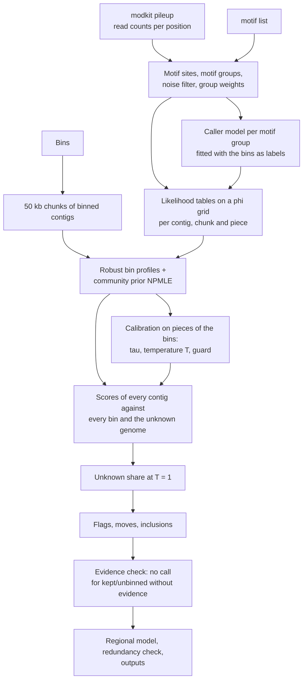

# Method notes (developer)

> **For users:** see [how-it-works.md](../how-it-works.md). These notes give the statistical model behind
> EpiRefine, how each part is estimated, how uncertainty is reported, and why each design choice was made.
>
> **Status (0.12).** The notes describe the model of version 0.12 at its defaults: the unknown genome is a random
> draw from the community on every run, its share among the unbinned contigs is estimated at temperature 1, the
> relatives statistic is reported but decides nothing ("option E", §7.7), the temperature is one value from a
> 31-point grid (§7.4), and a calibration that ends at the cap of that grid makes no call (§7.8). Module and
> function names are given in each section; options with their defaults. The calibration designs removed in 0.12,
> with why each was not kept, are listed in §7.6. Every number quoted from a dataset is labelled development (the data the defaults were chosen
> on) or spent (the monoculture test and validation communities, looked at during development). Earlier versions
> of these notes described EpiRefine's predecessor, a plasmid-host assigner; its parts that EpiRefine does not have
> (own methyltransferases of a plasmid, plasmid parameters δ and τ_p, plasmid statuses) are removed. The design
> history is in the development log's `DECISIONS.md`.

---

## Contents

1. [Problem statement](#1-problem-statement)
2. [Overview](#2-overview)
3. [Data and features](#3-data-and-features)
4. [The generative model](#4-the-generative-model)
5. [Scoring a contig against a bin](#5-scoring-a-contig-against-a-bin)
6. [Estimating the model's parameters](#6-estimating-the-models-parameters)
7. [Calibration on pieces of the sample's own bins](#7-calibration-on-pieces-of-the-samples-own-bins)
8. [Decisions, uncertainty and no calls](#8-decisions-uncertainty-and-no-calls)
9. [Why this approach](#9-why-this-approach)
10. [Assumptions and limitations](#10-assumptions-and-limitations)
11. [Validation](#11-validation)
12. [Computation](#12-computation)
13. [Parameter reference](#13-parameter-reference)
14. [Notation](#14-notation)
15. [References](#15-references)

---

## 1. Problem statement

A metagenome assembly holds contigs from many organisms, and a binner groups them into bins
(metagenome-assembled genomes). Binners use sequence composition and coverage, and they make two kinds of error:
a bin holds contigs of another genome (contamination), and contigs of a binned genome stay unbinned (incompleteness).

Bacterial DNA methyltransferases (MTases) modify adenine or cytosine at specific sequence motifs (for example 6mA
at G**A**TC, 4mC or 5mC at other motifs). Each strain has its own set of active MTases (its *methylome*), and every
DNA molecule replicated in the cell carries their marks. Nanopore sequencing reads these marks directly, and
Nanomotif (Heidelbach *et al.*) finds the motifs that are methylated in each bin. Methylation is measured
separately from composition and coverage, so it can find binning errors the binner cannot see.

**The task.** For every contig $u$ of the assembly, given the read counts at the motif sites, the bins and the motif
list, compute:

- a posterior over the bins **and an explicit "unknown genome" class** (a genome of the sample without a bin);
- for a binned contig, the probability that it does not belong to its bin, and a call: kept, flagged, or moved to
  another bin;
- for an unbinned contig, a call: included into a bin, or left unbinned;
- whether the data can support a call at all; where they cannot, **no call**.

---

## 2. Overview

The pipeline (`pipeline.run`) runs in this order:

1. motif groups from a sample of the assembly; one streaming pass over the pileup into a site cache (`sites.py`);
2. the noise filter and the group weights; the caller model per motif group (`detection.py`);
3. likelihood tables on the methylation grid for every contig, every 50 kb chunk of a binned contig and every
   calibration piece (`model.py`, `grid.py`);
4. robust bin profiles and the community prior, fitted for every value of the variation parameter τ, and the
   calibration on pieces cut from the bins: τ, the temperature $T$, the relatives statistic (`calibrate.calibrate`);
   the calibration guard (`calibrate.calibration_guard`);
5. scores of every contig against every bin (binned contigs leave-one-out) and against the unknown genome;
6. the unknown share at $T = 1$ and the decisions (`calibrate.calibrate_decisions`, `refine.refine`);
7. the methylation-evidence check (`assignability.py`), the regional model of long contigs, the redundancy check
   (`redundancy.py`) and the outputs (`refine.write_outputs`).

The method is a **hierarchical model**:

$$
\underbrace{k_i \mid n_i, s_i}_{\text{calls at a site}}
\;\leftarrow\; \underbrace{s_i \mid \phi_{um}}_{\text{site methylated?}}
\;\leftarrow\; \underbrace{\phi_{um} \mid \phi_{hm}, \tau_m}_{\text{contig vs bin}}
\;\leftarrow\; \underbrace{\phi_{hm}}_{\text{bin methylome}}
\;\leftarrow\; \underbrace{\pi_m}_{\text{community}}
$$

**Learned from the sample itself:** the caller's error rates per motif group, the bin profiles, the community
prior, the variation between contigs and their bin, the temperature, the share of unbinned contigs from genomes
without a bin and the contamination rate. **External information:** only the motif list. The decision thresholds
are fixed defaults that were chosen on development data (§13).

---

## 3. Data and features

*Modules: `io.py`, `motifs.py`, `sites.py`.*

### 3.1 Inputs

| Input | Content used |
|---|---|
| Assembly FASTA | contig sequences (motif search, redundancy check) and lengths |
| `modkit pileup` bedMethyl | per position, strand and modification code: $N_{\text{valid}}$ (column 10, reads with a valid call) and $N_{\text{mod}}$ (column 12, reads called modified). Codes other than `a`, `m`, `h`, `21839` are ignored, rows with $N_{\text{valid}} = 0$ dropped |
| `contig_bin.tsv` | the bins; contigs not listed are unbinned |
| motif table (Nanomotif `bin-motifs.tsv`) | the **union** of motifs: sequence (IUPAC), modification type as a modkit code, 0-based modified position, and `motif_complement` where given |

**Only the motif list is taken from Nanomotif**, not its per-bin calls. Which bins methylate which motif is
estimated from the read counts (§6). A motif needs to be found in at least one bin to be used.

### 3.2 Records and sites

A motif is matched on both strands of every contig. An occurrence on the forward strand at $s$ with modified
position $p$ gives a record at $(s + p, +)$; an occurrence of the reverse complement at $s$, of length $\ell$, gives a
record at $(s + \ell - 1 - p, -)$. A record is joined to pileup rows of its own modification code only.

The unit of evidence is a **site**. With the default `--strand-sites sum`, the two records of one occurrence of a
palindrome (GATC), or of a motif listed with its reverse complement of the same modification type
(`--complement-pairs sequence`, for example a Type I bipartite pair), form one two-strand site; other motifs give
single-strand sites. For site $i$ with matched rows $r$,

$$
n_i = \sum_r N_{\text{valid},r}, \qquad k_i = \sum_r N_{\text{mod},r} .
$$

No site is reduced to a methylated or unmethylated call; the counts are the data. Sites with $n_i <$ `--min-cov` (1)
are not used in the likelihood.

### 3.3 Motif groups

Motifs that measure the same bases are merged into **motif groups**, the features of the model. Two motifs of one
modification type join when they are a reverse-complement pair, or when the Jaccard index of their sets of matched
bases is at least `--min-jaccard` (0.9), measured on whole contigs drawn at random (seeded by `--seed`) until they
total `--group-sample-mb` (50 Mb), or on the whole assembly if it is smaller. Merging is transitive. A nested
motif (RGATCY in GATC) overlaps its parent too little and stays a group of its own.

A base matched by motifs of several groups is counted once: it goes to the group whose member motifs have the
fewest records in the sample (`--shared-sites sample`), and within the group to the member with the most records.
Each read count therefore enters one site of one group, and a methyltransferase that methylates one motif is not
seen again through an overlapping motif of another group.

### 3.4 Coverage, length and "5x"

A contig's coverage $\text{cov}_u$ is the median of $n_i$ over all its sites (all groups, before the noise filter;
0 without sites). Because $n_i$ sums both strands at two-strand sites, $\text{cov}_u$ counts valid calls per site,
not read depth: at a read depth $D$ a palindromic site has $n \approx D$ and a single-strand site $n \approx D/2$ (fewer
where modkit filtered calls), and the median mixes the two. "5x", the default `--min-contig-coverage`, means
$\text{cov}_u \ge 5$ in this sense. With `--strand-sites auto`, sites stored as single strands are counted double
here. Contigs below the coverage cut-off, or shorter than `--min-contig-length` (1,000 bp), get no call (§8.2).

### 3.5 Noise filter and group weights

Two steps act on the groups before any model is fitted.

- **Noise filter** (`motifs.noisy_groups`; off with `--no-motif-noise-filter`). On binned contigs with
  $\text{cov}_u \ge 10$, a contig is noise-like for a group when it has at least 20 sites with $n \ge 5$, a mean
  read fraction $k/n$ in $[0.15, 0.6]$, and at least 20% of those sites at $0.2 < k/n < 0.8$; a bin is noise-like
  when at least half of its measured contigs are. A group is dropped when noise-like bins number at least 3 and make
  up at least 20% of the bins that measure it (and, with `--noise-max-off-share` below 1, at most that share of its
  bins are unmethylated). A real motif is methylated at (nearly) all of a genome's sites or at none; a group whose
  sites are intermediate in many genomes is a caller leak (on ZymoFecal, development: 4mC calls in CCNGG-type
  contexts, most likely 5mC leaking into the 4mC call).
- **Group weights** (`motifs.redundancy_weights`; off with `--no-group-weights`). A group is "on" in a bin when more
  than half of at least 50 sites with $n \ge 5$ have $k/n > 0.5$. Two groups that can share a modified base and are
  "on" in the same bins (Jaccard index of their "on" bins at least 0.9 over at least 5 bins that measure both, each
  "on" in at least two) are linked; each group of a linked cluster $C$ gets weight $v_m = 1/|C|$, others 1. One
  methyltransferase seen through several motif variants then counts once.

### 3.6 Units and chunks

A **unit** $u$ is a stretch of sequence scored as one: a **contig**; a **chunk**, one of the 50 kb pieces
(`--chunk-size`) of a binned contig, from which bin profiles are built (chunks without sites are dropped); or a
**calibration piece** cut from a binned contig (§7.1). A contig is always scored as a whole; its chunks matter for
its own bin's profile (left out when it is scored, §5) and for the regional model (§8.6).

---

## 4. The generative model

*Modules: `detection.py`, `grid.py`, `model.py`.*

### 4.1 Detection layer: calls given a site's state

Each site $i$ of group $m$ is methylated ($s_i = 1$) or not ($s_i = 0$). Given the state, the number of reads called
modified is beta-binomial:

$$
k_i \mid n_i, s_i \;\sim\; \mathrm{BetaBin}\!\big(n_i;\; \mu_{s m}\kappa_{s m},\; (1-\mu_{s m})\kappa_{s m}\big),
\qquad
\mathrm{BetaBin}(k; n, a, b) = \binom{n}{k} \frac{B(k + a,\, n - k + b)}{B(a, b)} .
$$

- $\mu_{0m} \in (0, 0.5)$: mean fraction of reads called modified at an *unmethylated* site, the caller's
  false-positive level in this sequence context;
- $\mu_{1m} \in (0.5, 1)$: the same at a *methylated* site, the detection ceiling;
- $\kappa_{0m}, \kappa_{1m} \in [0.3, 10^4]$: concentrations; small $\kappa$ = strong overdispersion between sites.

The binomial coefficient is the same under every hypothesis and is dropped from the likelihoods (it is kept in the
expected-evidence sums of §8.5).

### 4.2 Site layer

Within unit $u$, the sites of group $m$ are methylated independently with probability $\phi_{um}$, the
**methylated fraction**. It is near 1 when the genome has an active MTase for the motif, near 0 when it has none,
and intermediate for partial or phase-variable methylation, or for a group whose motifs are only partly methylated.
Summing over the state, the per-site log-likelihood at $\phi = x$ is

$$
\ell_m(n, k; x) = \log\big[x\, f_{1m}(k \mid n) + (1 - x)\, f_{0m}(k \mid n)\big],
$$

and the unit table is the weighted sum over its sites,

$$
L_{umg} = v_m \sum_{i \in u,\; m(i) = m,\; n_i \ge n_{\min}} \ell_m(n_i, k_i; x_g) .
$$

A unit without sites in a group has a flat table (0): missing data are neutral. The group weight $v_m$ acts as a
power on the group's likelihood.

### 4.3 The φ grid

$\phi$ is represented on $G$ = `--grid-size` (64) points $x_1 < \dots < x_G$, evenly spaced in logit between
$10^{-3}$ and $1 - 10^{-3}$, so the grid is fine near 0 and 1 where nearly all genomes sit. Cell edges are the
logit midpoints, with 0 and 1 outside. Densities are stored as cell masses (CDF differences), so the uneven spacing
adds no bias; log-likelihoods are stored per grid point and reused for every hypothesis.

### 4.4 Unit layer: how a contig varies around its bin

A unit of a genome with level $x_g$ need not have exactly that level. With the default `--variation beta`,

$$
\phi_{um} \mid \phi_{hm} = x_g \;\sim\; \mathrm{Beta}\big(x_g \tau_m,\; (1 - x_g)\tau_m\big),
$$

integrated out on the grid:

$$
L'_{umg} = \log \sum_{g'} K^{(\tau_m)}_{g g'}\, e^{L_{umg'}},
$$

where $K^{(\tau)}_{gg'}$ is the mass of that Beta distribution in cell $g'$; $\tau = \infty$ makes $K$ the identity
(no variation). $\tau_m$ is chosen per group by the calibration (§7.3). `--variation logit` uses a logit-normal
kernel with spread $\sigma$ instead.

### 4.5 Bin layer: bin profiles

With chunk weights $w_c \in [0, 1]$ (§6.3), bin $h$'s log-likelihood in group $m$ is

$$
\Lambda_{hmg} = \sum_{c:\, b_c = h} w_c\, L'_{cmg},
$$

and its **profile** is the posterior over its level, $p_{hmg} \propto \pi_{mg}\, e^{\Lambda_{hmg}}$.

### 4.6 Community layer

$\pi_{m\cdot}$ is the distribution of bin levels in group $m$ across the community, estimated nonparametrically
from all bins (§6.2).

### 4.7 The unknown genome

A sample always holds genomes without a bin (not binned, low abundance, not assembled). EpiRefine models such a
genome as a **random draw from the community**: each group's level is drawn independently from $\pi_{m\cdot}$. Its
likelihood is the prior predictive,

$$
S^U_u = \sum_m \log \sum_g e^{L'_{umg}}\, \pi_{mg} .
$$

A contig whose methylation is unlike every bin, but plausible for a genome of this community, scores higher here
than under any bin. This is the only unknown model used for decisions since 0.12 (§7.7). An alternative model, in
which an unknown genome can also be an unbinned *relative* of a bin (each group's level taken from that bin with
probability $1 - \eta$ and from the community otherwise, mixed with the community draw at weight $\lambda$), is
fitted during calibration only to compute the relatives statistic (§7.7).

---

## 5. Scoring a contig against a bin

*Module: `model.py` (`FittedModel.score`, `loo_rescore_many`, `posterior`).*

The score of unit $u$ under bin $h$ is

$$
S_{uh} = \sum_m \log \sum_g e^{L'_{umg}}\, p_{hmg} .
$$

Groups are treated as conditionally independent given the bin; a group without sites adds 0. For a **binned
contig**, its own bin's score is leave-one-out: the weighted contributions of the contig's chunks are removed from
$\Lambda_{b_u}$ and the profile is rebuilt with the same $\pi$, so the contig does not vouch for itself. A contig
that holds all of its bin's chunks has no independent profile and is not tested (`sole_contig_of_bin`).

**How the evidence works.** The motif groups act as a panel of nearly binary markers, weighed by the likelihood:

- **Positive evidence.** A contig methylated at a motif that only bin $h$ methylates is strong evidence for $h$;
  it grows with the number of sites and their calls.
- **Negative evidence.** A contig *unmethylated* at a motif that $h$ methylates is strong evidence *against* $h$.
  Absence of a mark is as informative as its presence.
- **Shared motifs.** A motif methylated by many bins (Dam GATC) separates those bins little, because all of them
  predict it; it still separates them from bins that lack it. No ad hoc motif weighting is needed.

---

## 6. Estimating the model's parameters

All estimation uses the sample itself; nothing is pre-trained.

| Step | Estimated | Data used | Method |
|---|---|---|---|
| 1 | $\mu_{sm}, \kappa_{sm}$ | sites of binned contigs, the bins as labels | maximum *a posteriori*, two levels (§6.1) |
| 2 | $\pi_m$, profiles $p_{hm}$, chunk weights $w_c$ | chunks | NPMLE by EM (§6.2), robust profiles (§6.3) |
| 3 | $\tau_m$, temperature $T$ | calibration pieces | leave-out likelihood; log loss (§7) |
| 4 | unknown share $\hat p$ | decidable unbinned contigs | EM at $T = 1$ (§7.7) |
| 5 | contamination rate $\hat\varepsilon$ | testable binned contigs | EM, Beta(1, 19) prior (§8.3) |

### 6.1 Caller model with the bins as labels

*Module: `detection.py` (`fit_detection_by_bin`).*

A motif is methylated in some genomes and not in others, so the bins label the data. For each group and bin with at
least 50 sites, the pooled read fraction $\sum k / \sum n$ labels the pair unmethylated when it is below 0.2 and
methylated when it is above 0.5; other pairs are not used. Per modification type, the unmethylated component is the
maximum-likelihood beta-binomial of the unmethylated pairs' sites; the methylated component is fitted on the
methylated pairs' sites as a mixture $\omega f_1 + (1 - \omega) f_0$ with $f_0$ fixed, so a methylated bin may be
partly methylated. Each group is then fitted the same way by maximum *a posteriori*, with a Gaussian prior (standard
deviation 2) on $(\operatorname{logit} 2\mu_0, \log\kappa_0)$ and $(\operatorname{logit}(2\mu_1 - 1), \log\kappa_1)$
centred on its modification type's fit. A group without unmethylated (methylated) pairs takes its type's component;
a type without labelled pairs of one kind uses fixed values ($\mu_0 = 0.05, \kappa_0 = 10$; $\mu_1 = 0.85,
\kappa_1 = 10$). Fits use L-BFGS-B from several starting points. Unbinned contigs do not enter the fit.
`detection_model.tsv` reports the fit; its `pi1` is the share of labelled sites that come from methylated bins.

(Earlier versions fitted the caller model as a two-component mixture on all sites of the sample. When few of many bins
methylate a motif, that pooled fit collapses: the second component absorbs the upper tail of unmethylated sites
instead of describing methylated ones. The labelled fit replaced it; dev log D19.)

### 6.2 Community prior: nonparametric maximum likelihood

For each group, $\hat\pi_m$ is the nonparametric maximum-likelihood estimate of the distribution of bin levels
(Kiefer and Wolfowitz 1956; Efron's g-modelling, 2016), by EM on the grid:

$$
\hat\pi^{(t+1)}_{mg} = \hat\pi^{(t)}_{mg}\, \frac{1}{H} \sum_h \frac{e^{\Lambda_{hmg}}}{\sum_{g'} \hat\pi^{(t)}_{mg'}\, e^{\Lambda_{hmg'}}},
$$

at most 300 iterations or until no cell moves by more than $10^{-6}$; each fit starts from the previous fit's
estimate (the uniform the first time). It is shrunk towards the mean $\bar\pi_{\theta(m)}$ of
the groups of its modification type with $\lambda_\pi = 5$ pseudo-bins and mixed with a uniform floor $f = 0.02$, so
no level is impossible:

$$
\pi_{mg} = (1 - f)\,\frac{H \hat\pi_{mg} + \lambda_\pi \bar\pi_{\theta(m) g}}{H + \lambda_\pi} + \frac{f}{G} .
$$

### 6.3 Robust bin profiles

Bins hold foreign sequence. Each chunk is taken to come from its bin with prior $1 - \varepsilon_0$ or from a random
community genome with prior $\varepsilon_0$ = `--contam-eps` (0.05). Its responsibility of being foreign is

$$
r_c = \sigma\Big(\log\tfrac{\varepsilon_0}{1 - \varepsilon_0}
+ \sum_m \log \sum_g e^{L'_{cmg}} \pi_{mg}
- \sum_m \log \sum_g e^{L'_{cmg}} p^{(-c)}_{b_c m g}\Big),
$$

with $p^{(-c)}$ the profile without chunk $c$ (without it a contaminating chunk would partly explain itself). The
weights $w_c = 1 - r_c$ and the profiles are refitted in turn, at most four rounds,
stopping early when no weight moves by more than $10^{-3}$. Foreign chunks are down-weighted, not removed;
`host_chunk_outliers.tsv` lists $r_c$. A bin whose weights still move after the last round is reported as
`not_converged` (`bin_evidence.tsv`): it may hold two methylomes in comparable shares. The same weights give the
**two-state screen** of `bin_evidence.tsv` (`two_state_share`).

---

## 7. Calibration on pieces of the sample's own bins

*Module: `calibrate.py`.*

Real samples have no ground truth. EpiRefine makes its own: **calibration pieces** are cut from binned contigs, so
their bin is known.

### 7.1 Pieces

From binned contigs with $\text{cov}_u \ge$ `--min-contig-coverage`, pieces of six lengths (`--frag-lengths`: 2, 5,
10, 20, 50 and 100 kb) are cut. Tiles of one length lie on a fixed grid along each contig and do not overlap. For
each bin and length, up to $\max(1, \min(30, \operatorname{round}(6000 / (\ell H))))$ tiles are drawn without
replacement ($\ell$ the number of lengths; `--frags-per-bin` 30, `--frag-budget` 6000; seeded by
`--calibration-seed`, which defaults to `--seed`). Each piece is scored as if it were unbinned, with its own bin's
profile rebuilt **without every chunk of its source contig**. Pieces whose bin would be empty without the source
contig, and pieces that overlap a chunk with robust weight $w_c < 0.5$ (their label is probably wrong), are not used.
If no binned contig is covered and long enough for the shortest piece, the run stops with the error "no calibration
fragments".

### 7.2 Two tests

| Test | Candidates | Right answer | Checks |
|---|---|---|---|
| A | all bins and the unknown genome | the piece's bin | accuracy and calibration when the genome has a bin |
| B | the piece's bin removed | the unknown genome | that a missing genome is recognised rather than replaced by a wrong bin |

Test B uses only **distinct** pieces: their bin has no **look-alike** (no other bin within 0.15 of its mean level in
every group, `lookalikes.tsv`) and the piece's expected log Bayes factor (§8.5, at $T = 1$) for its bin over the
best-scoring other bin is at least 3. Where a bin cannot be told from a sibling, removing it does not make "unknown"
the right answer for any method.

### 7.3 The variation parameter τ

For each $\tau \in \{3, 10, 30, 100, 300, 1000, 10^4, \infty\}$ the model (robust profiles and community prior) is
fitted and the kept pieces are scored against their own bin. Each group takes the τ that maximises the sum of its
leave-out group terms over the pieces that fit keeps. If the groups disagree, a model with per-group $\tau_m$ is
fitted and replaces the best single τ when its summed own-bin log-likelihood is higher (`tau_fit.tsv`,
`tau_groups.tsv`). `--tau` overrides.

### 7.4 Temperature

$S_{uh}$ treats sites and groups as conditionally independent. That is not exact (sites on one read are correlated,
methylation varies along a genome), so raw posteriors are overconfident. One temperature $T$ divides the scores
$S_{uh}$ and $S^U_u$ in the posteriors and the decisions; priors are not divided (Guo *et al.* 2017). Let $p_0$ =
0.1 (or `--p-unknown`) be a reference share of unknown genomes, with bin prior $(1 - p_0)/H$:

$$
P^A_j(T) = \frac{\tfrac{1 - p_0}{H} e^{S_{j b_j}/T}}{\sum_{h} \tfrac{1 - p_0}{H} e^{S_{jh}/T} + p_0\, e^{S^U_j/T}},
\qquad
P^B_j(T) = \frac{p_0\, e^{S^U_j/T}}{\sum_{h \ne b_j} \tfrac{1 - p_0}{H} e^{S_{jh}/T} + p_0\, e^{S^U_j/T}},
$$

$$
\mathcal{L}(T) = \frac{1}{|\mathcal{A}|} \sum_{j \in \mathcal{A}} -\log P^A_j(T)
+ \frac{1}{|\mathcal{B}|} \sum_{j \in \mathcal{B}} -\log P^B_j(T),
$$

over the kept pieces $\mathcal{A}$ and the distinct pieces $\mathcal{B}$ (probabilities floored at $10^{-12}$; the
test-A mean alone when $\mathcal{B}$ is empty). The two tests weigh the same whatever their sizes.

- **Grid.** $\hat T$ minimises $\mathcal{L}$ over 31 values log-spaced from 0.2 to 20 (`calibrate.DEFAULT_TEMPS`,
  rounded to 3 decimals). Neighbouring values differ by a factor $100^{1/30} \approx 1.166$.
- **Never sharpen.** Only $T \ge 1$ is used (`--allow-sharpening` lifts this). The pieces are cut from binned
  contigs, which are easier to place than real unbinned contigs: they can show overconfidence but cannot justify
  more confidence. The smallest usable value is the first grid value above 1, **1.082**; the largest is the
  **cap, 20**. `fitted_temperature` in `params.json` is the best grid value without this restriction.
- **Why test B is included.** With test A only, evidence against "unknown" is never checked, which led to
  overconfident placements of contigs whose genome had no bin.
- `--temperature` overrides the fit (and bypasses the guard, §7.8).

**Limitation: the grid step.** The temperature moves in steps of about 17%, and the number of inclusions follows
the step: on the ZymoFecal tuning sets (development), about one resample of the calibration bins in six landed one
grid step away from the full fit, which moved inclusions by about 17%. A continuous search between grid points was
tried (98% of resamples within 15% of the full fit, against 83%) but changed a written criterion on the simulated
look-alikes, so 0.12 keeps the grid (dev log D75 and the 2026-11-13 ledger).

**One temperature for all lengths.** The temperature each piece length would want alone rises with length
(`temperature_by_length.tsv`; on ZymoFecal, development, from about 3 at 2 kb to about 14 at 500 kb), so one
temperature leaves very long contigs overconfident and short ones underconfident. A temperature that grows with
the number of sites is an option (`--temperature-law sites`), not the default.

### 7.5 Reported tables

`calibration/` holds, per piece length and overall: accuracy, mean confidence, expected calibration error over 10
confidence bins, log loss, 95% credible-set coverage and size, and the test-B rates of "unknown" and of confident
(≥ 0.95) wrong calls, uncalibrated, at the fitted and at the calibrated temperature (`summary.tsv`); a reliability
table (`reliability.tsv`); the τ and T fits; accuracy by expected evidence (`assignability.tsv`); the look-alikes;
the pieces themselves; and two tables at the settings the decisions use: the share of true member pieces that
would be flagged (`false_flag_rate.tsv`) and the reliability of the deployed posteriors (`reliability_deployed.tsv`).
Every column is described in [outputs.md](../outputs.md#the-calibration-folder). Together they give a
sample-specific picture of how short a contig can be and still be placed reliably in this sample.

### 7.6 The relatives statistic's standard error (`bin-parsimony`), and the calibration designs removed in 0.12

*Code: `calibrate.calibrate`, `calibrate.clustered_se`.*

The calibration is the one of §7.1-7.4 (that of 0.10), with one change since 0.11.1, `bin-parsimony`: the relatives
test takes its standard error from a bootstrap over bins (400 replicates resampling whole source bins) instead of
over single pieces. The evidence for relatives comes from sibling pairs of bins, and a few bins hold most of it
(ZymoFecal, Nanomotif 1.3.0 motifs, development: 5 of 213 bins held 44% of the test-B gain), so pieces are not
independent: the gain 0.142 is 2.9 SE over pieces but 1.8 SE over bins, and the relatives model that the per-piece SE
let the test select sent $p_\text{unknown}$ to 1 (no inclusions). On the simulated look-alikes, where every bin has an
unbinned sibling, the gain stays at 5 SE over bins (development). Since 0.12 the unknown model is no longer chosen
(§7.7): `bin-parsimony` is built in and only sets how the relatives statistic's standard error is computed; it
decides again only under the deprecated `--relatives switch`.

Up to 0.11.1 `--calibration` selected further designs of single steps of the calibration. None became a default
and the option was removed in 0.12 (dev log U12, D63); `--relatives switch` reproduces the 0.11.1 default
(`--calibration default`). What each did and why it was not kept (development data):

| Removed design | What it changed | Why not kept |
|---|---|---|
| `temper-then-mix` | Each explanation of "unknown" tempered, then mixed, as the bins are (the order of 0.10 also tempers the weights $1/H$). No effect when $\lambda = 1$ | Changed no decision while $\lambda = 1$; with it the switch chose relatives at 4.6 SE on ZymoFecal and nothing was included (D59, candidate 1b). Option E uses $\lambda = 1$ |
| `prior-averaged`, `prior-matched`, `full-test-b` | A proper objective (tests weighted $(1-p, p)$, averaged over priors or at the estimated prior; test B over every piece) | Never confirmed on a metagenome; a cost in put back on the training communities; superseded by the unknown share at $T = 1$ (option E, §7.7) |
| `unit-temperature` | $T = 1$ on the grid | Contig posteriors at exactly $T = 1$ overconfident (83% right at P 0.9-0.95 on the training communities) |
| `conservative-temperature` | The flattest $T$ within 2 SE of the best | Without the proper objective no gain; with it only costs inclusions |
| `sites-temperature` | $T$ rising with the number of sites, per piece length | Worse than one temperature where its guard let it act; the smooth law `--temperature-law sites` (experimental) replaces it |
| `common-tau` | $\tau$ compared on the pieces every fit keeps | Changed no decision on the development sets |
| `em-priors` | Beta(2, 2) prior on $p_\text{unknown}$; contamination rate after the gate | No decision changed; the gated rate is still `--eps-gated` |
| `tempered-bin-prior` | The bin prior $\log(H)/T$ (a module-level switch) | On ZymoFecal it made the switch choose relatives decisively: 1 inclusion. Option E estimates the share at $T = 1$ instead |
| `deployed-unknown` | The unknown model checked at its deployed prior | On the look-alikes wrongly placed contigs 2 -> 19 (D51) |
| `legacy` | The SE over single pieces (0.10, 0.11.0) | The ZymoFecal inclusion collapse (D50, D51) |

### 7.7 The unknown model since 0.12 (option E)

*Code: `pipeline.resolve_unknown_model`, `pipeline.run` (calibration and decision blocks), `calibrate.calibrate`,
`calibrate.calibrate_decisions`, `calibrate._relatives_statistic`.*

Up to 0.11.1 the calibration chose between two unknown models per sample: the community draw ($\lambda = 1$) and
the mixture with relatives ($\lambda < 1$, $\eta \in \{0.02, 0.05\}$, $\lambda \in \{0.1, 0.5, 0.9\}$), keeping the
relatives when the best relatives row of the temperature fit beat the best community-only row by 2 SE (over bins
since `bin-parsimony`). That choice is removed. Every run now:

1. fits the temperature grid (§7.4) for every unknown model (`temperature_fit.tsv`) and computes the **relatives
   statistic**: the gain $\Delta$ in $\mathcal{L}$ of the best relatives row over the best community-only row, each at
   its own temperature $\ge 1$ (negative when the community model fits better), its standard error over bins
   (400 bootstrap replicates of whole source bins, fixed seed), and $\Delta/\text{SE}$. It is written to one log line
   and to `params.json` `relatives_statistic`, with what the 2-SE rule of 0.11.1 would have chosen
   (`switch_choice`); with one bin it is not computed. **It changes no score or call**;
2. uses the best community-only row ($\lambda = 1$, its $T \ge 1$) whatever the statistic says. When the 2-SE rule
   would have chosen the relatives, `params.json` records what it would have used (`unknown_model_forced`), and the
   temperature in use is the community-only row's;
3. estimates the **unknown share** $\hat p$, the share of decidable unbinned contigs that come from genomes without
   a bin, by EM at $T = 1$ with the bins equally likely (`--unknown-share t1`):
   $$
   \hat p = \arg\max_p \sum_{u \in \mathcal{U}} \log\Big[(1 - p)\,\frac{1}{H}\sum_h e^{S_{uh}} + p\, e^{S^U_u}\Big],
   $$
   starting from 0.5, at most 500 iterations, tolerance $10^{-8}$, kept in $[10^{-6}, 1 - 10^{-6}]$ (`--p-unknown`
   fixes it). $\hat p$ is then held fixed in the decisions (`p_unknown`, `p_unknown_t1` in `params.json`). At the
   deployed temperature, the untempered $1/H$ prior gives "unknown" $\log(H)(1 - 1/T)$ of extra log odds, so an
   estimate made there rose with $T$ (ZymoFecal, development: 0.41 at $T = 1$, 0.69 at 5.02);
4. makes the decisions (§8) with that $\hat p$ at the calibrated $T$;
5. runs the methylation-evidence check after the decisions, at the same $T$ (§8.5).

**Why.** The choice sat on a knife edge: on ZymoFecal (Nanomotif 1.3.0 motifs, development) the statistic was 0.4 to
1.9 SE on five sets of calibration pieces, and on three tuning sets the switch chose relatives in 20%, 13.5% and
2.5% of 200 resamples of the calibration bins; every replayable flip ended with no or almost no inclusion (the
relatives model absorbs the unbinned contigs, $\hat p \to 1$). With the switch removed and the share at $T = 1$,
200 of 200 resamples kept the outcome on each set (dev log D61-D63; development data).

**What it costs.** The relatives model existed for genomes without a bin that copy a bin's methylation. Without
it, contigs of such a genome are placed into the sister bin when their methylation matches (simulated look-alikes,
development: 112 placements over three sets, all exact or near copies of a bin's methylome: identical, differing
only in a phase-variable or unmodelled motif, or in a modelled motif with at most 2 sites on the contig). On such a
sample the temperature also rises, because test-B pieces of a removed bin are confidently scored to its sister
(look-alikes: $T$ 3.7-4.3, against 1.26 under 0.11.1), and since the evidence check divides by $T$, more short
contigs get no call (about 12-35% of the contigs there; §8.5, §10). The relatives statistic is the warning: near 0
or below, the pieces give no sign of unbinned relatives; above about 2 they do (development: 0.4-1.9 on ZymoFecal,
4.4-5.4 on the simulated look-alikes).

**The 0.11.1 path.** `--relatives switch` (deprecated, hidden from `--help`) restores the switch of 0.11.1, with
$\hat p$ estimated at the deployed temperature unless `--unknown-share` is given; it reproduces 0.11.1. A run with `--no-calibrate` (no fit to
force to community only) takes it when `--relatives` is not given, and says so in the log. `epirefine rerun` of a
`params.json` written before 0.12 uses it too (a record that used an option removed in 0.12 is refused). The
designs with a relatives weight per bin (`--relatives per-bin`, `--relatives slot`) were removed in 0.12: on the
development look-alikes they placed many contigs wrongly (D59, D60).

### 7.8 The calibration guard

*Code: `calibrate.calibration_guard`, `pipeline.run` (after the calibration block).*

On the default path (option E, no `--temperature`), the run checks whether the calibrated temperature is at the cap
of the grid (20). If so, it makes **no call**: the contamination and inclusion thresholds are set beyond 1 for the
run, so no contig is flagged, included or moved, and the posteriors are written at the cap for inspection only. One
log line (`WARNING: calibration guard: ...`) and `params.json` `calibration_guard` (`fired`, `reason`,
`temperature`, `cap`, `pieces`, `test_b_pieces`, `fallback`) say so; on every other calibrated run
`calibration_guard.fired` is false. `include_contigs.tsv` then lists no candidate. With `--temperature-law sites` the decisions use the
law's temperature, so the guard is checked on the law instead (`calibrate.calibration_guard_law`): it fires when the
law's temperature at 1,000 sites is at the upper bound of its search (100).

**Why the cap and not the number of pieces.** A temperature at the boundary of the search means no tempering the
grid allows predicted the pieces better: the loss is flat in $T$ (pieces without usable sites) or still falling at
20 (pieces confidently wrong); either way the fit gives no temperature to decide with. On development data the
temperature is at most 5.9 on every normal run (monoculture training set, ZymoOral, simulated look-alikes, ZymoFecal
and 600 bin resamples of its calibration, fecal_inhouse) and either at most 1.7 or exactly 20 on the 653 finished
runs of stress set 2; nothing lies in between, so the check does not sit on a fitted threshold. Counts of pieces do
not separate: from a single calibration piece the fit usually lands at the never-sharpen floor (1.082) and the calls
are right (stress set 2, development: tens of runs, flag precision 100%), so a guard on few pieces would remove
correct calls. The three stress runs at the cap made no call under option E anyway (the contamination rate falls to
0 at $T = 20$, and every contig has evidence / $T$ below 3; $\hat p$, which option E estimates at $T = 1$ and so
does not depend on the calibrated temperature (§7.7), was 0 on those runs); the guard makes this explicit and
guarantees it on data where some calls would survive $T = 20$. A fixed fallback temperature was rejected: $T = 1$
on one of those runs placed 25 contigs, one wrongly, where the calibration had found the scores untrustworthy.

---

## 8. Decisions, uncertainty and no calls

*Modules: `calibrate.calibrate_decisions`, `refine.py`, `assignability.py`, `redundancy.py`.*

### 8.1 Posterior and credible set

For every contig EpiRefine reports a posterior over the $H$ bins and the unknown genome,

$$
P(h \mid u) \propto \frac{1 - \hat p}{H}\, e^{S_{uh}/\hat T}, \qquad P(\text{unknown} \mid u) \propto \hat p\, e^{S^U_u/\hat T},
$$

with its most probable label (`map`, `p_map`), $P(\text{unknown} \mid u)$ (`p_unknown`) and the **95% credible set**,
the smallest set of labels, by decreasing probability, holding at least 0.95 (`credible_set_95`). It makes ambiguity
explicit: two bins with identical methylomes both appear. This posterior gives the own bin no special prior; the
decisions below use their own priors.

### 8.2 Decidable and testable contigs

Calls are made only for **decidable** contigs: $\text{cov}_u \ge$ `--min-contig-coverage` (5, §3.4) and length at
least `--min-contig-length` (1,000 bp). Others get no call (`low_coverage`, `too_short`) and do not enter $\hat p$ or
$\hat\varepsilon$. A binned contig is **testable** when it is decidable, has at least one motif site and is not the
sole contig of its bin.

### 8.3 Flags

For contig $u$ the alternatives are every bin except its own ($H_u = H - 1$ bins if binned, $H$ if unbinned) and the
unknown genome:

$$
A_u = \log\Big[\sum_{h \ne b_u} \frac{1 - \hat p}{H_u}\, e^{S_{uh}/\hat T} + \hat p\, e^{S^U_u/\hat T}\Big],
\qquad
P_u(\text{foreign}) = \sigma\big(\operatorname{logit}\hat\varepsilon + A_u - S_{u b_u}/\hat T\big),
$$

where the contamination rate $\hat\varepsilon$ is the maximum *a posteriori* weight of the two-component mixture
(Beta(1, 19) prior, the EM routine of §7.7) over the testable binned contigs. A testable contig is **flagged**
(`contaminant`) when $P_u(\text{foreign}) \ge$ `--contamination-threshold` (0.5) and its methylome differs from the
bin's by at least `--min-methylome-difference` (0.4): in at least one group with sites, the 95% interval of the
contig's own level (from $L_{um\cdot}$ normalised over the grid) lies at least 0.4 from the bin's mean level
$\bar\phi_{b_u m}$ (full profile, contig included; `--gate-leave-out none`). The gate keeps many small, consistent
shifts (variation within one genome, which the likelihood alone reads as strong evidence) from adding up to a flag;
a foreign genome usually differs by a whole motif (dev log D20). $\hat\varepsilon$ is estimated before the gate
withdraws flags, so it is a discordance rate and can exceed the share flagged. With one bin no contig is tested for
contamination and $\hat\varepsilon$ is not estimated.

### 8.4 Inclusions and moves

The best alternative $a_u$ is the most probable of the alternatives above, with probability $q_u$ given that the
contig does not belong to its input bin (`best_alternative`, `p_best_alternative`). An unbinned contig is
**included** into $a_u$, and a flagged contig is **moved** to it, when $a_u$ is a bin and $q_u \ge$
`--include-threshold` (0.9); the threshold is `--include-threshold-unmethylated` (0.95) when the target bin shows no
methylation (`no_methylation_detected`), because such a bin matches every contig without methylation at the listed
motifs, including contigs of genomes whose motifs are not in the list. A flagged contig that is not moved leaves
its bin and joins none. A bin of a single contig accepts inclusions (plasmids, phages).

### 8.5 The evidence check and what a no call means

*Module: `assignability.py`.*

A low probability can mean conflicting evidence or no evidence. The **expected evidence** separates them: the log
Bayes factor a contig's sites would give, on average, for its bin $\hat b_u$ (its input bin; for an unbinned contig
$\arg\max_h S_{uh}$) over a community draw, if its true levels were the bin's mean levels $\bar\phi_{\hat b_u m}$. It
uses the Asimov dataset (Cowan *et al.* 2011): the observed counts are replaced by their expectation under the
hypothesis. The expected per-site log-likelihood is linear in the true level,

$$
E^{(s)}_m(n; g) = \sum_{k=0}^{n} \tilde f_{sm}(k \mid n)\, \ell_m(n, k; x_g)
$$

($\tilde f$ the beta-binomial pmf with its binomial coefficient, $n$ capped at 500), so the expected unit table is
$\bar L_{umg} = v_m \sum_i \big[\bar\phi_{\hat b_u m} E^{(1)}_m(n_i; g) + (1 - \bar\phi_{\hat b_u m}) E^{(0)}_m(n_i; g)\big]$
over the sites of groups kept by the noise filter, and after the variation kernel

$$
E_u = \frac{1}{\hat T}\Big(\sum_m \log\sum_g e^{\bar L'_{umg}}\, p_{\hat b_u m g} - \sum_m \log\sum_g e^{\bar L'_{umg}}\, \pi_{mg}\Big)
$$

(`expected_evidence`). It uses only site positions and read counts, not the observed modified counts, so it cannot
be self-serving.

**The rule.** A contig whose call would be `kept` (binned) or `unbinned`, and whose $E_u$ is below `--min-evidence`
(3) or undefined (no sites), gets **no call**: status `no_methylation_evidence`. Its staying in its bin, or staying
unbinned, is not supported by methylation, and the status says so instead of reporting a decision.

**What a no call means, and what it does not.** The status is written last, after the flags, moves and inclusions
are fixed, and it only relabels `kept` and `unbinned` contigs. **A no call never changes a bin**: a binned contig
with `no_methylation_evidence` stays in its bin in `new_contig_bin.tsv`, an unbinned one stays unbinned, and no flag,
inclusion, move, estimate ($\hat p$, $\hat\varepsilon$) or refined bin depends on it. Because $E_u$ is divided by
$\hat T$, the share of no calls rises with the temperature: on the simulated look-alikes (development), where option
E raises $T$ to 3.7-4.3, 12-35% of the contigs get no call (§7.7, §10). Since 0.12 the check uses the temperature of
the decisions, the community-only fit's (dev log D66).

`calibration/assignability.tsv` checks, on the pieces, how well the expected evidence predicts accuracy, and
`fragments.tsv` gives it per piece (`expected_log_bf_vs_nearest`, against the nearest other bin;
`expected_log_bf_vs_unknown`, against a community draw).

### 8.6 Long contigs: the regional model

A long contig can be partly foreign (a chimeric assembly), and a flag would then remove good sequence. For each
binned decidable contig with at least two chunks with sites, flagged or not, the chunk evidence
$d_c = \operatorname{logit}(1 - w_c) - \operatorname{logit}\varepsilon_0$ is taken from the robust fit
(`--regional-leave-out chunk`). Three explanations are compared: member (log-likelihood 0), foreign ($\sum_c d_c$),
and mixed, a two-state chain along the chunks with switch probability 0.05 per chunk that excludes the two pure
paths; their prior weights are estimated by EM over all such contigs. A flag is withdrawn when
$P(\text{mixed}) > P(\text{foreign})$ (`--regional-withdraw vs_foreign`): the contig stays in its bin with status
`mixed` (also when it would have been moved), and its likely foreign chunks are reported (`foreign_segments`,
`segment_bins`). Nothing is split. Off with `--no-regional-model` or `--contam-eps 0`.

### 8.7 Redundancy check

Methylation cannot see whether a bin already holds a contig's sequence (a strain variant or haplotig). An inclusion
or move must add sequence: EpiRefine compares a FracMinHash sketch of the contig (canonical 21-mers, scale 1/50)
with the union of the sketches of the target bin's unflagged input contigs (`--redundancy-order independent`). If
at least `--max-redundancy` (0.3) of the contig's sketch is in the bin, the inclusion or move is dropped
(`redundancy_with_bin`): an unbinned contig becomes `redundant`, a flagged contig stays flagged and joins no bin.

### 8.8 Status

The status column is assigned in this order, later rules overriding earlier ones: `kept` / `unbinned`;
`contaminant`; `sole_contig_of_bin`; `redundant`; `included` / `moved`; `no_methylation_evidence` (only on `kept` /
`unbinned`, §8.5); `low_coverage`; `too_short`; `mixed`. When the guard fires (§7.8) no contig is `contaminant`,
`moved` or `included`. The table of statuses is in [outputs.md](../outputs.md#statuses).

---

## 9. Why this approach

### 9.1 A likelihood model rather than a distance or a classifier

Methylation-based binning and host linking (Beaulaurier *et al.* 2018; Tourancheau *et al.* 2021) and earlier
methylation-based bin refinement compare per-contig motif methylation summaries by distance or with classifiers.
A likelihood model does what those cannot easily do:

| Need | How the likelihood handles it |
|---|---|
| Short contigs with few sites | Each site contributes in proportion to its calls; a 3-site motif is automatically weaker than a 300-site one. A summary such as "fraction methylated" hides this. |
| Coverage differences | Calls enter directly; a site at 2 calls is weak evidence, one at 200 strong. |
| Negative evidence | Unmethylated sites of a bin's motif count against that bin at their full information value. |
| Shared motifs | Motifs common to many bins are down-weighted where they do not discriminate. |
| An open set of genomes | "Unknown" is a hypothesis with its own likelihood, not a distance threshold. |
| Uncertainty | Posteriors, credible sets and Bayes factors come out of the model. |

### 9.2 Separating measurement from biology

The caller's behaviour varies strongly by motif context (on ZymoOral, development, $\mu_0$ ranged from 0.002 to 0.03
and $\mu_1$ from 0.81 to 0.98 across well-identified groups). A threshold on "fraction of reads modified" mixes
this with biology. The two-level site model keeps the caller's error profile ($\mu$, $\kappa$) apart from $\phi$,
the fraction of sites methylated, which is comparable across motifs, modification types and coverage. The
beta-binomial is used because calls are overdispersed relative to a binomial (context varies, some sites are
partly methylated, reads are not independent draws); a binomial would make every high-coverage site overconfident.

### 9.3 Empirical Bayes from the sample itself

Caller behaviour depends on chemistry, basecaller and model version, and every community is different, so
pre-trained parameters would be stale. Each metagenome holds its own training data: motifs that most bins do not
methylate give many unmethylated sites, motifs that some bins methylate give methylated ones, and the bins label
which is which. Shrinking motif-specific estimates towards the modification type lets groups with little
information borrow strength.

### 9.4 A discrete grid instead of conjugate formulas

The model is not conjugate (a mixture over site states, a bimodal community prior, a Beta transition). A 64-point
grid in logit space makes every integral an exact finite sum and every density a vector: marginalising the unit
level is a matrix product, scoring a unit against all bins one product per group. No MCMC is needed and results are
deterministic.

### 9.5 A nonparametric community prior

Bin methylation levels are strongly bimodal (an active MTase for a motif or none). A unimodal prior would be badly
wrong and a hand-made two-component one would need tuning; the NPMLE takes the shape from the data, and shrinkage
and a floor make it stable with few bins and never dogmatic. It regularises profiles of small bins and defines the
unknown genome (§9.6).

### 9.6 "Unknown" as the prior predictive

An open-set rule that rejects the best match beyond a distance threshold has no probabilistic meaning and must be
tuned per dataset. EpiRefine asks how probable the data would be for a genome drawn at random from this community:
"unknown" wins exactly when no bin explains the data better than a typical community member would; it inherits the
community's motif frequencies; and it sits on the same scale as the bin likelihoods, so it is calibrated with them.
The price is that a genome without a bin but with a bin's methylation looks like that bin (§10).

### 9.7 Chunks, τ and leave-one-out

Treating each 50 kb chunk as a unit lets methylation vary along a genome through τ, stops one long contig from
dominating its bin's profile, and makes leave-one-out scoring possible even when a bin is one complete chromosome.
τ is chosen by leave-out likelihood on the calibration pieces, the standard way to set a variance component without
overfitting.

### 9.8 Robust profiles

A contaminating contig makes its bin's profile look as if it had a second methylome, which damages every decision
about that bin. The mixture "chunk from the bin vs. from a random community member" is a soft, likelihood-based
outlier trimming: clearly foreign chunks are down-weighted to near zero, ordinary chunks keep a weight near 1, and
the leave-one-out step prevents a contaminant from validating itself.

### 9.9 Self-calibration

In a real metagenome nobody knows the true bins, so a method's stated confidence is usually unverifiable. Pieces of
the sample's own bins give a sample-specific check with known answers, at the sample's own coverage, motifs and
caller. Test B adds the open-set check. The one-sided temperature (flatten only) reflects the known blind spot of
pieces cut from binned contigs.

### 9.10 Removing the unknown-model choice (option E)

A default must not sit on a knife edge. The per-sample choice of the unknown model flipped under resampling of the
calibration and, when it flipped, removed nearly all inclusions (§7.7). One model on every run, with its share
estimated where it does not move with the temperature, is stable; its cost (look-alike genomes, §10) is stated and
flagged by the relatives statistic rather than handled by a choice that is not stable.

### 9.11 Expected evidence

Users need to tell "this contig is unbinned because its genome has no bin" from "this contig has too little
information". The expected Bayes factor is computed before looking at methylation, is on the same scale as the
observed evidence, and the linearity in the true level makes it cheap for every contig.

---

## 10. Assumptions and limitations

**Model assumptions.**

1. **Conditional independence** of sites and motif groups given the bin. Violations (correlated sites on a read; one
   MTase's sites spread over several groups) make raw posteriors overconfident. The temperature corrects this on
   average, not per contig, and one temperature for all lengths leaves long contigs overconfident (§7.4). The group
   weights and the single-group assignment of shared bases reduce double counting.
2. **One genome per contig.** A contig present in two genomes (a broad-host-range plasmid) gives a mixed signal; it
   shows up with several labels in the credible set or as a flag.
3. **Contaminants look like random community members.** A bin that is a near 50/50 merge of two genomes, or whose
   two genomes differ in a single sparse motif, is not resolved by the robust step; `bin_evidence.tsv` marks it
   (`two_methylation_states`, `large_flagged_share`).
4. **A uniform prior over bins.** Abundance, coverage ratio and taxonomy are not used.

**Unbinned genomes with a bin's methylation (since 0.12, §7.7).** Contigs from a genome without a bin whose
methylation equals, or nearly equals, a bin's are placed into that bin; methylation alone cannot separate the two
genomes. On such samples the temperature rises, so more short contigs get no call (`no_methylation_evidence`). The
relatives statistic in `params.json` flags such samples.

**What a no call means.** `no_methylation_evidence` is a label on contigs that would be `kept` or `unbinned`; it
never changes a bin (§8.5). Its share depends on the temperature: on the simulated look-alikes (development) it ranged
from about 12% to 35% of the contigs depending on where the temperature landed (set s1: 245, 396 and 619 of 1,849
contigs at $T$ 3.7, 4.3 and 5.0).

**The temperature grid step (§7.4).** One grid step (about 17%) can move the number of inclusions by about the same
share; on the ZymoFecal tuning sets (development) about one resample of the calibration bins in six did.

**A calibration at the cap gives no calls (§7.8).** When the temperature ends at 20, the run makes no call;
`--temperature` overrides with an uncalibrated temperature.

**Calibration blind spots.** The pieces are cut from binned contigs, so they are easier to place than real unbinned
contigs, and they share the bin's own sequence context. Mobile elements methylated unlike their host (phages with
their own MTases, high-copy plasmids partly unmethylated) are not represented by the pieces; such elements are left
unbinned when unbinned and can be flagged when binned.

**Inputs.** The motif discovery must find the relevant motifs: a motif needs to be found in at least one bin. A genome
whose motifs are all missing from the list looks unmethylated and matches bins without methylation (hence the
stricter inclusion threshold for them). The motif table can change the results a lot.

**Caller model.** Groups methylated in at most one bin have few labelled methylated sites; their methylated
component then rests on the modification type's fit.

---

## 11. Validation

The benchmarks and their results are kept outside these notes:

- `benchmarks/` and `benchmarks/results.tsv` in this repository: the monoculture benchmark (training communities:
  development data; test and validation communities: spent, they were looked at during development), with one
  summary row per version;
- the `CHANGELOG.md` entry of each version: the measured effect of every change on the development data, and its
  known limitations;
- the separate benchmark-workflow repository: the mock communities, simulated sets, stress sets and the fecal
  samples with Hi-C (development data);
- the manuscript (in preparation), which is to report the evaluation on held-out data, run once on a frozen
  version.

The test suite (`tests/`) checks the model's parts on a synthetic community (`tests/synth.py`) with planted
contaminants, missing members, a genome without a bin, a duplicate and low-coverage and short contigs, including a
golden snapshot of every decision (`tests/test_golden.py`).

---

## 12. Computation

The pipeline streams the pileup once into a site cache and never holds all motif records, or a
[units × bins × groups] tensor, in memory. Memory, speed and the batching of each step are described in
[scalability.md](scalability.md); measured times per version are in the [FAQ](../faq.md#how-long-does-it-take-and-how-much-memory).

---

## 13. Parameter reference

| Symbol | Option | Default | Set by |
|---|---|---|---|
| $n_{\min}$ | `--min-cov` | 1 | fixed |
| motif merge | `--min-jaccard`, `--group-sample-mb` | 0.9, 50 Mb | fixed |
| $G$ | `--grid-size` | 64 | fixed |
| $C$ | `--chunk-size` | 50 kb | fixed |
| $\mu, \kappa$ (caller) | — | — | maximum *a posteriori* with the bins as labels (§6.1); prior SD 2 |
| $\lambda_\pi$, $f$ | — | 5, 0.02 | fixed (prior shrinkage, floor) |
| $\varepsilon_0$ | `--contam-eps` | 0.05 | fixed (0 turns the robust profiles and the regional model off) |
| $\tau_m$ | `--tau`, `--variation` | calibrated per group; Beta kernel | leave-out likelihood over {3, 10, 30, 100, 300, 1000, 10⁴, ∞} |
| $T$ | `--temperature`, `--allow-sharpening` | calibrated, 1.082 to 20 | log loss of tests A + B on a 31-point grid (§7.4) |
| $p_0$ (calibration) | `--p-unknown` | 0.1 | fixed reference prior in the temperature fit |
| $\hat p$ (decisions) | `--p-unknown`, `--unknown-share` | estimated at $T = 1$ | EM over the decidable unbinned contigs (§7.7) |
| unknown model | `--relatives` | community only | fixed since 0.12 (§7.7) |
| $\hat\varepsilon$ | — | estimated | EM, Beta(1, 19) prior (§8.3) |
| pieces | `--frag-lengths`, `--frags-per-bin`, `--frag-budget`, `--calibration-seed` | 2-100 kb, 30, 6000, `--seed` | fixed |
| look-alike | — | 0.15 | fixed |
| test B | — | expected log BF ≥ 3 | fixed |
| flag | `--contamination-threshold`, `--min-methylome-difference` | 0.5, 0.4 | chosen on development data |
| inclusion | `--include-threshold`, `--include-threshold-unmethylated` | 0.9, 0.95 | chosen on development data |
| redundancy | `--max-redundancy` | 0.3 | chosen on development data |
| no call | `--min-evidence`, `--min-contig-coverage`, `--min-contig-length` | 3, 5, 1,000 bp | chosen on development data |
| regional switch | — | 0.05 per chunk | fixed |
| evidence $n$ cap | — | 500 | fixed |
| guard | — | temperature at the grid cap (20) | fixed (§7.8) |

---

## 14. Notation

| Symbol | Meaning |
|---|---|
| $i$ | motif site (one methylation event; may combine both strands) |
| $n_i, k_i$ | valid calls / calls modified at site $i$ |
| $s_i$ | site methylated (1) or not (0) |
| $m$, $v_m$ | motif group, its weight |
| $u$ | unit: contig, chunk or calibration piece |
| $h, b_u$ | bin; the input bin of contig $u$; $H$ bins in total |
| $\mu_{sm}, \kappa_{sm}$ | caller mean and concentration for state $s$ in group $m$ |
| $f_{sm}(k \mid n)$ | beta-binomial likelihood for state $s$ |
| $\phi_{um}, \phi_{hm}$ | fraction of sites methylated in a unit / bin |
| $x_g$, $G$ | grid points, their number |
| $L, L'$ | unit log-likelihood on the grid, before / after the variation kernel |
| $\tau_m$, $K^{(\tau)}$ | variation parameter, its kernel |
| $\Lambda_{hm}$, $p_{hm}$ | bin log-likelihood, bin profile |
| $\pi_m$ | community prior over bin levels |
| $w_c, r_c$ | chunk weight and its foreign responsibility |
| $S_{uh}$, $S^U_u$ | score of $u$ under bin $h$ / under the unknown genome |
| $T$ | temperature |
| $\hat p$, $\hat\varepsilon$ | unknown share, contamination rate |
| $E_u$ | expected evidence |
| $\eta, \lambda$ | relatives model: swap share per group, community weight (statistic only) |

---

## 15. References

- Beaulaurier J. *et al.* (2018). Metagenomic binning and association of plasmids with bacterial host genomes using
  DNA methylation. *Nature Biotechnology* 36, 61–69.
- Cowan G., Cranmer K., Gross E., Vitells O. (2011). Asymptotic formulae for likelihood-based tests of new physics.
  *European Physical Journal C* 71, 1554.
- Efron B. (2016). Empirical Bayes deconvolution estimates. *Biometrika* 103, 1–20.
- Guo C., Pleiss G., Sun Y., Weinberger K. Q. (2017). On calibration of modern neural networks. *ICML 2017*.
- Heidelbach S. *et al.* Nanomotif: identification and exploitation of DNA methylation motifs in metagenomes using
  Oxford Nanopore sequencing.
- Kass R. E., Raftery A. E. (1995). Bayes factors. *Journal of the American Statistical Association* 90, 773–795.
- Kiefer J., Wolfowitz J. (1956). Consistency of the maximum likelihood estimator in the presence of infinitely many
  incidental parameters. *Annals of Mathematical Statistics* 27, 887–906.
- Tourancheau A. *et al.* (2021). Discovering multiple types of DNA methylation from bacteria and microbiome using
  nanopore sequencing. *Nature Methods* 18, 491–498.
